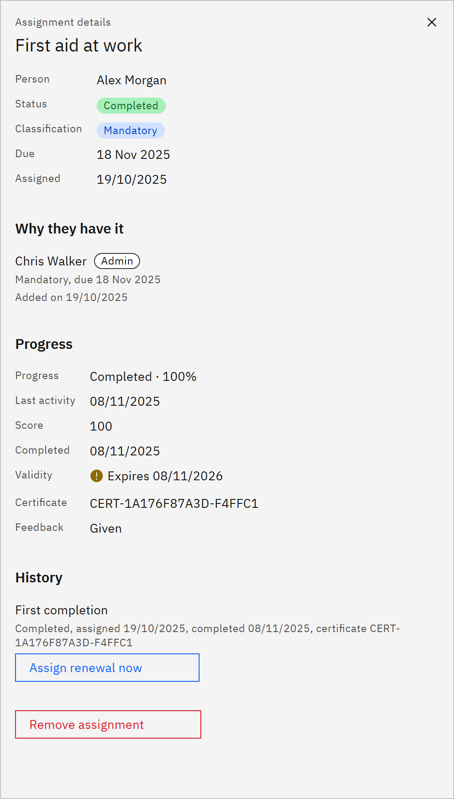

# Assign a renewal early

You can ask someone to renew completed learning before it expires, for example after a policy change. You need the
**HR manager** or **Organisation administrator** role.

1. Open the assignment

   In **Manage** ▸ **Learning assignments**, find the completed assignment, open the row menu and choose **View
   details**.

2. Assign the renewal

   Under **History**, click **Assign renewal now** on the completed cycle. The button only appears when the learning
   can be renewed.

   

3. Check the result

   A message confirms the renewal, or says the person already has one. The renewal is a new cycle, due on the date the
   previous completion expires. No email is sent. Earlier completions and certificates stay on record.
