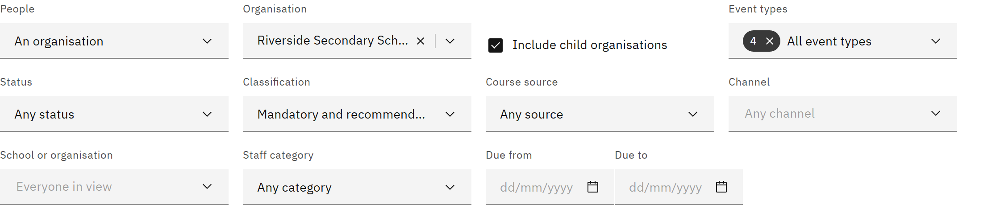

# Use the deadlines calendar

The deadlines calendar shows when learning is due, when course feedback is due, and when completions expire or need
renewing, for the people you can see. You need the **Line manager**, **Learning manager**, **Report viewer**, **HR
manager** or **Organisation administrator** role.

1. Open the calendar

   Click **Manage** in the header, then **Deadlines calendar** under **Organisation**. It opens on the widest group of
   people you can see.

2. Choose whose deadlines to show

   Under **People**, choose **Your line reports** (if people report to you), **An organisation** (learning managers and
   report viewers) or **Everyone** (HR managers and organisation administrators). For **An organisation**, choose it
   under **Organisation**; if you have only one, it's chosen for you. Tick or clear **Include child organisations**.
   Changing **People** clears the **School or organisation** and **Staff category** filters.

   

3. Choose the month and view

   Use **Previous month**, **Today** and **Next month**. The **Month** tab shows a grid; click a day to list its
   deadlines underneath. The **Agenda** tab lists every day in the month that has deadlines, with "(today)" on today.

4. Open a deadline

   Click a deadline to see it in the panel on the right. Deadlines for the same course on the same day are grouped:
   see [See who is due for a course](./17-see-who-is-due-for-a-course.md). Dates are calendar dates in UTC.

5. Share the view

   The month, view and filters are kept in the page address, so you can bookmark or share it. Someone else only sees
   the people they're allowed to see.
