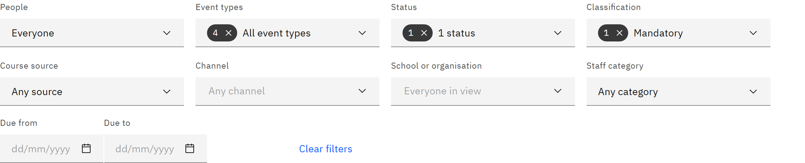

# Filter the deadlines calendar

The filters narrow the deadlines calendar to what you need, such as overdue mandatory learning in one school. You need
the **Line manager**, **Learning manager**, **Report viewer**, **HR manager** or **Organisation administrator** role.

1. Choose the event types

   Under **Event types**, choose any of **Assignment due**, **Feedback due**, **Expiry** and **Renewal due**. If you
   clear them all, the calendar asks you to choose at least one.

   

2. Narrow by status and course

   Under **Status**, choose states such as **Assignment overdue**, **Feedback pending** or **Expiry: expiring soon**.
   Under **Classification**, choose **Mandatory** or **Recommended**. Under **Course source**, choose **Created in the
   LMS** or **From HR**. Under **Channel**, choose one or more channels.

3. Narrow by people

   Under **School or organisation**, choose units within the people in view. Under **Staff category**, choose
   categories such as Teacher or Support staff.

4. Set a date range

   Enter **Due from** and **Due to**. If the range is outside the month you're looking at, the calendar offers a button
   to go to that month.

5. Clear the filters

   Choices within one filter are combined with "or"; different filters must all match. If nothing matches, the calendar
   says **No deadlines match these filters**. Click **Clear filters** to start again.
