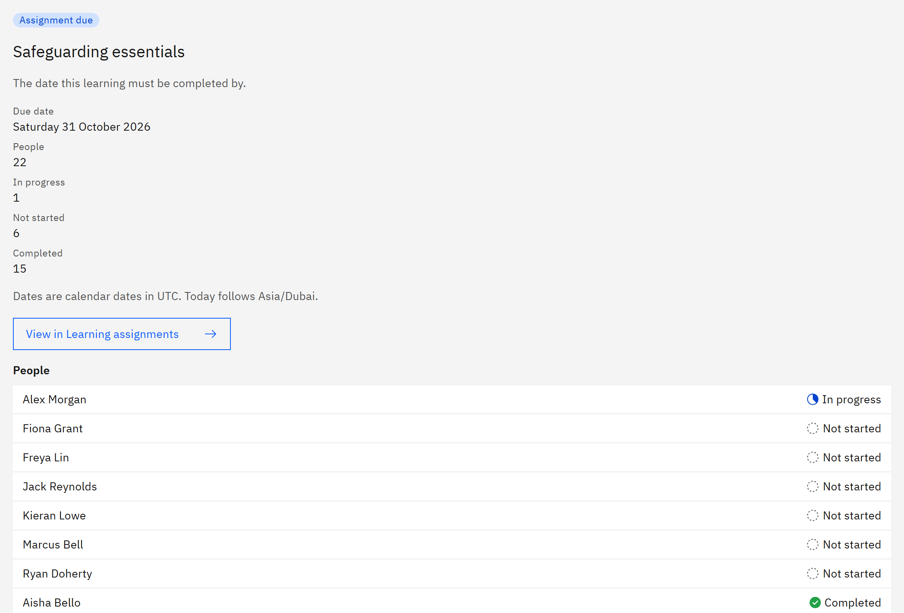

# See who is due for a course

When many people have the same course due on the same day, the deadlines calendar shows it once, so a course due for
hundreds of people stays one line. You need the **Line manager**, **Learning manager**, **Report viewer**, **HR
manager** or **Organisation administrator** role.

1. Find the course

   In **Manage** ▸ **Deadlines calendar**, find the course on its day. The line shows the type of deadline, the course,
   the number of people and how many are in each state, for example "1 overdue · 3 in progress · 20 not started". The
   most urgent state is shown at the end.

2. Open it

   Click the course. The panel on the right shows the date, the number of **People**, and a count for each state.
   **People** lists everyone, most urgent first. For more than 50 people, use **Search people** to find someone.

   

3. Open a person

   Click a person to see their own deadline, with their classification and learning cycle. Click **Back to all
   people** to return to the group.

4. Work on the list

   Click **View in Learning assignments** to open the list of assignments for that course, filtered to the same people.
   It's shown when you're looking at **Everyone** or **An organisation**; line reports don't have this link.
