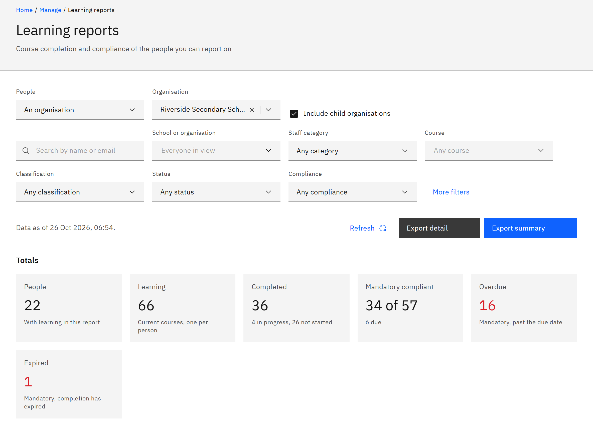

# Open learning reports

**Learning reports** shows course completion and mandatory compliance for the people you can report on, with totals
and a detailed list. You need the **Line manager**, **Learning manager**, **Report viewer**, **HR manager** or
**Organisation administrator** role.

1. Open Learning reports

   Click **Manage** in the header, then **Learning reports** under **Organisation**.

2. Choose whose learning to report on

   Under **People**, choose **Everyone** (HR managers and organisation administrators), **An organisation** (learning
   managers and report viewers) or **Your line reports** (if people report to you). For **An organisation**, choose it
   under **Organisation** and tick or clear **Include child organisations**. Until you choose an organisation, the page
   asks you to.

   

3. Read the totals

   **Totals** shows the **People** with learning in the report, their **Learning** (current courses, one per person),
   how much is **Completed**, how much mandatory learning is compliant, and how much is **Overdue** or **Expired**.
   Overdue and Expired count mandatory learning only.

4. Read the detail

   **People and courses** lists one row per person and course, with their **School**, **Staff category**,
   **Classification**, **Cycle**, **Status**, **Compliance**, **Due date**, **Validity** and **Feedback**. Click **Show
   more** to load more rows.

5. Refresh the data

   The line above the totals says when the data was read, for example "Data as of 25 Oct 2026, 09:30." Click
   **Refresh** to read it again.
