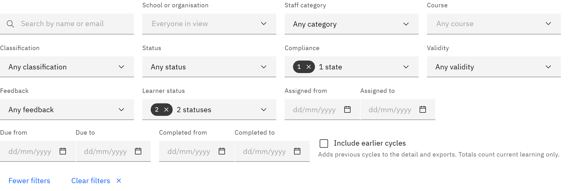

# Filter a learning report

Filters narrow a learning report, for example to overdue mandatory learning for teachers in one school. You need the
**Line manager**, **Learning manager**, **Report viewer**, **HR manager** or **Organisation administrator** role.

1. Use the main filters

   In **Manage** ▸ **Learning reports**, type a name or email in **Search people**, or choose a **School or
   organisation**, **Staff category**, **Course**, **Classification** (**Mandatory**, **Recommended** or **Not
   assigned**), **Status** (**Not started**, **In progress** or **Completed**) and **Compliance** (**Compliant**,
   **Due**, **Overdue** or **Expired**). The choices only include people and courses in the report.

   

2. Use more filters

   Click **More filters** to add **Validity** (for example **Expiring soon**), **Feedback** (for example **Overdue**),
   **Learner status** and the **Assigned**, **Due** and **Completed** date ranges. **Learner status** includes everyone
   by default; choose **Deactivated or disabled** to see people who've left or whose account is disabled.

3. Include earlier cycles

   Tick **Include earlier cycles** to add previous cycles of renewed courses to the detail and exports. Totals always
   count current learning only.

4. Clear the filters

   Choices within one filter are combined with "or"; different filters must all match. Click **Clear filters** to
   start again, or **Fewer filters** to hide the extra ones.
