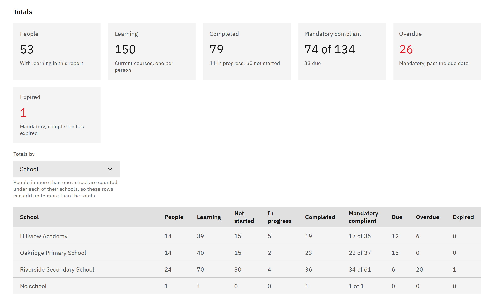

# Break down report totals

The totals table compares compliance across courses, schools or staff categories. You need the **Line manager**,
**Learning manager**, **Report viewer**, **HR manager** or **Organisation administrator** role.

1. Choose the breakdown

   In **Manage** ▸ **Learning reports**, under **Totals by**, choose **Course**, **School** or **Staff category**.

   

2. Read the table

   Each row shows its **People** and **Learning**, how much is **Not started**, **In progress** and **Completed**, and
   for mandatory learning how much is compliant, **Due**, **Overdue** and **Expired**. People in more than one school are
   counted under each school, so school rows can add up to more than the totals.

3. Calculate totals for large reports

   For more than 2,000 people, the page says **Totals are calculated in the background**. Click **Calculate totals**.
   The rows below still load page by page while you wait, and the line above the totals says when they were calculated.
   Totals are reused for an hour.
