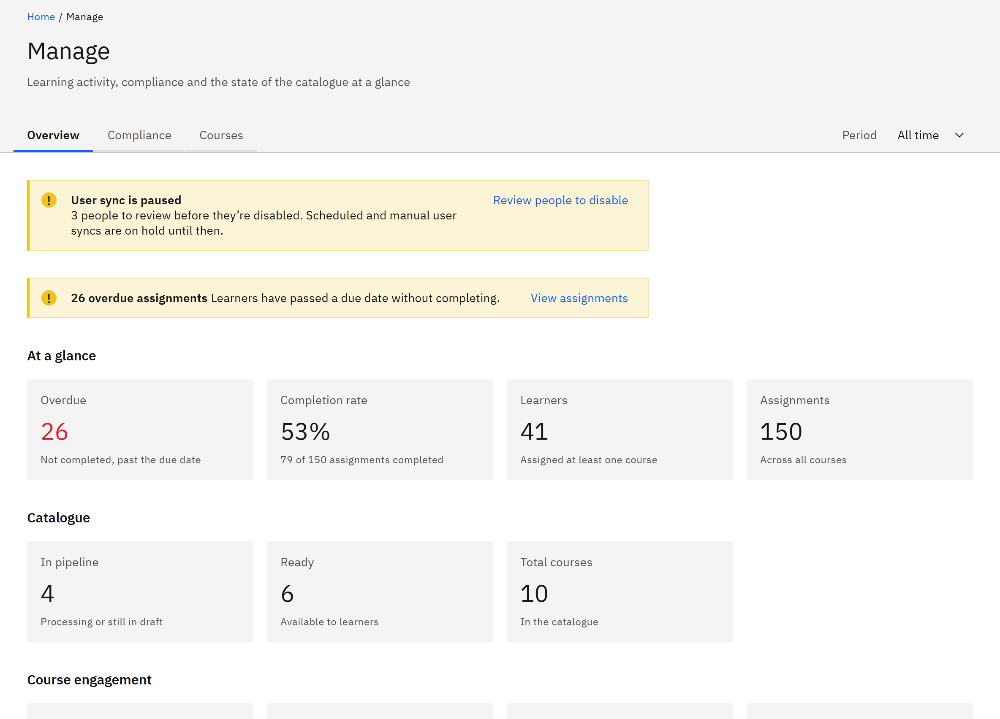

# Read the Manage overview

The overview is the first page of **Manage**: learning activity, compliance and the state of the catalogue at a
glance. You need the **Course manager**, **HR manager** or **Organisation administrator** role.

1. Open the overview

   Click **Manage** in the header, or **Overview** in the side navigation. Under **Period**, choose **All time**,
   **Last 30 days**, **Last 90 days** or **Last 12 months**.

2. Act on overdue learning

   If any learning is overdue, a message says how many assignments are overdue. Click **View assignments** to open
   **Learning assignments**.

   

3. Read At a glance

   **Overdue** counts learning not completed by its due date. **Completion rate** shows how many assignments are
   completed. **Learners** counts people assigned at least one course, and **Assignments** counts assignments across
   all courses.

4. Read Catalogue

   **In pipeline** counts courses processing or still in draft, **Ready** counts courses available to learners, and
   **Total courses** counts the whole catalogue. **Failed** or **Quarantined** appear only when a course needs
   attention.

5. Read engagement and attention

   **Course engagement** shows **Learners** who opened a course, **Sessions**, **Completions** and the **Average
   completion rate**, with courses ranked by learners. **Requires attention** lists courses below full completion,
   lowest first. **Recently added courses** lists the newest courses and their status.
