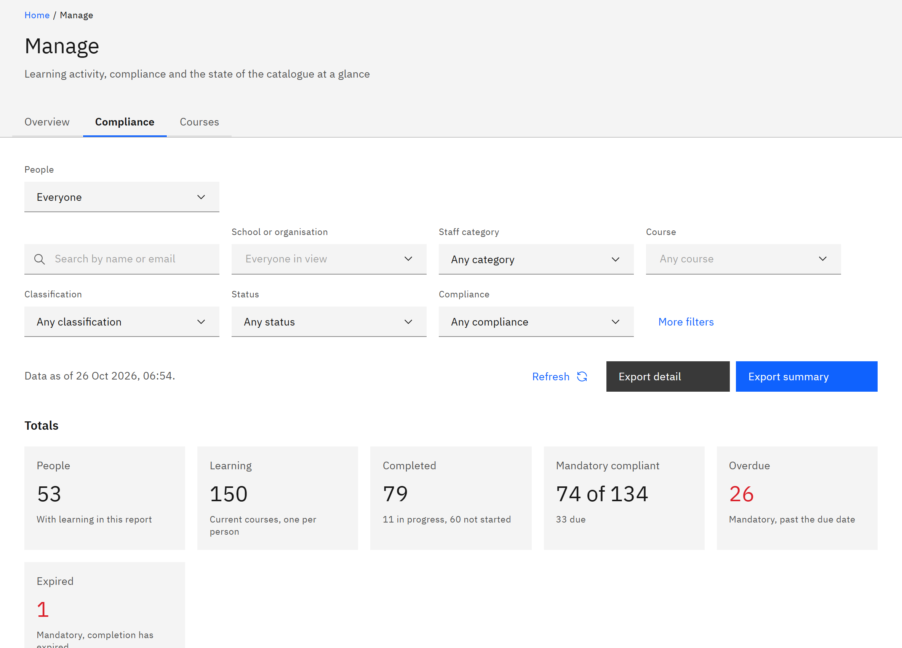

# View compliance on the overview

HR managers and administrators can see compliance and course charts on the **Manage** overview, without opening
**Learning reports**. You need the **HR manager** or **Organisation administrator** role. Course managers see only the
overview.

1. Open the Compliance tab

   Click **Manage** in the header, then the **Compliance** tab. It's the same report as **Learning reports**, with the
   same **People** choice, filters, totals and exports. See [Open learning reports](./01-open-learning-reports.md).

   

2. Open the Courses tab

   Click the **Courses** tab for charts across the whole organisation: **Completion overview**, **Course performance**
   (courses per channel, completion rate and average score per course), **Activity trends** (learner activity in the
   last 30 days), **Skills and channels**, and **Assignment growth** (assignments created in the last 6 months).

3. Go back to the overview

   Click the **Overview** tab to return to the at-a-glance tiles.
