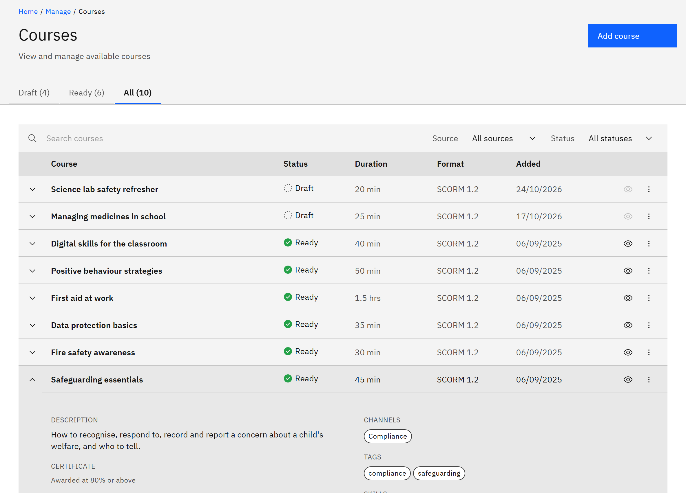

# Find a course to manage

The **Courses** page in **Manage** lists every course in your catalogue, including drafts learners can't see. You need
the **Course manager** or **Organisation administrator** role.

1. Open Courses

   Click **Manage** in the header, then **Courses** under **Content**.

2. Choose a tab

   **Draft** lists courses that aren't published yet, **Ready** lists published courses, and **All** lists everything,
   including courses still processing. Each tab shows its count.

   

3. Search and filter

   Type in **Search courses**. Under **Source**, choose **From HR** or **Created in the LMS**. On the **All** tab you can
   also filter by **Status**.

4. Read a row

   Each row shows the **Course** title, with "v2" (or later) when it has newer versions and tags such as **From HR**,
   **In person** or **Expired**. It also shows **Duration**, **Format** (SCORM 1.2 or SCORM 2004) and when it was
   **Added**.

5. See the details

   Click the arrow at the start of a row to expand it. You'll see the description, expiry, certificate rule,
   channels, tags, skills, versions and metadata such as who created and last uploaded it, and any **Status detail**.

6. Preview or act on the course

   Click the **Preview** icon to open a ready course as a learner would. Open the row menu for **Edit details**,
   **Replace or add a version**, **Mark ready** or **Move to draft**, and **Delete course**.
