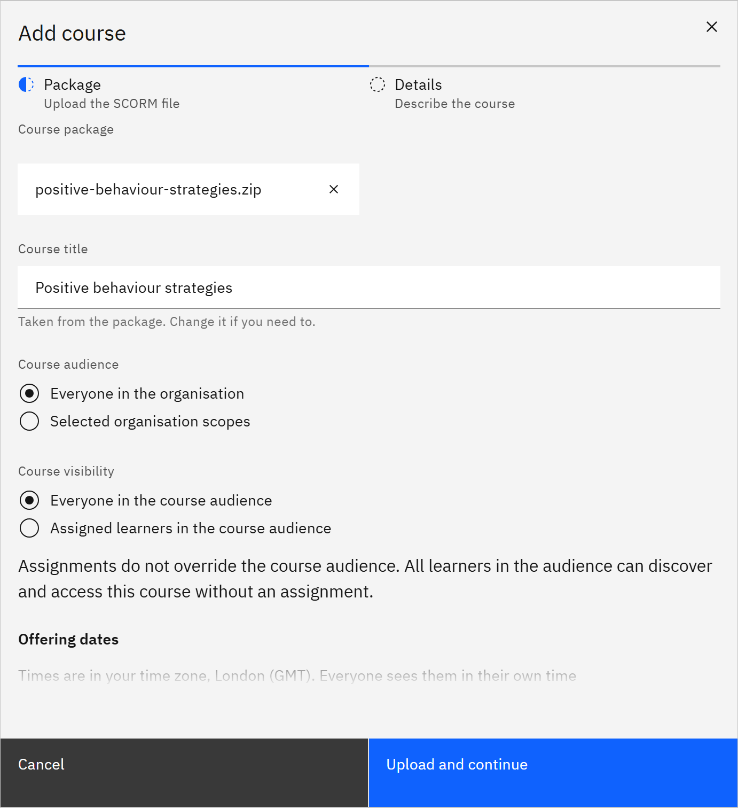

# Add a course

You add a course by uploading its SCORM package, a .zip file, and describing it. You need the **Course manager** or
**Organisation administrator** role.

1. Start adding

   In **Manage** ▸ **Courses**, click **Add course**. The window has two steps: **Package** and **Details**.

2. Upload the package

   Drag the SCORM .zip file onto **Course package**, or click to browse. GrowthXP reads the package
   and fills in the **Course title**; change it if you need to.

   

3. Choose who can see it

   Under **Course audience**, choose **Everyone in the organisation** or **Selected organisation scopes**. Under
   **Course visibility**, choose whether everyone in the audience can find it, or only people who are assigned it. See
   [Choose who can see a course](./07-choose-who-can-see-a-course.md). You can also set **Offering dates** for your HR
   system.

4. Upload and continue

   Click **Upload and continue**. When the package is accepted, the **Details** step opens. Processing carries on in
   the background while you work.

5. Add the details

   Add a **Description**, **Estimated duration (minutes)**, **SCORM version**, **Tags**, **Skills** and **Channels**.
   Under **Certificate**, choose a **Certificate template** and a **Minimum grade required (%)**. Set an **Expiry date**
   if the course should stop being available on a date.

6. Save the course

   Click **Save course**, or **Finish later** to add the details another time. The new course is a draft. Once its
   status is **Draft**, publish it with **Mark ready**: see
   [Publish or unpublish a course](./06-publish-or-unpublish-a-course.md).
