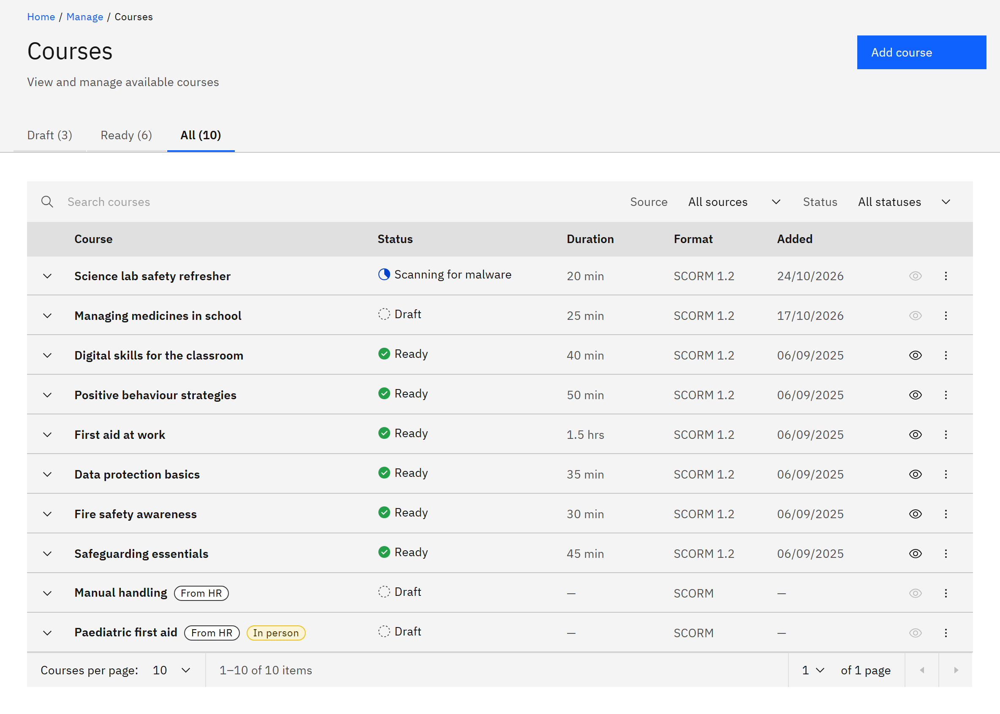

# Check a course upload

Every SCORM package is checked for malware and unpacked before learners can use it. You can follow its progress on
the **Courses** page. You need the **Course manager** or **Organisation administrator** role.

1. Find the course

   In **Manage** ▸ **Courses**, open the **All** tab. The list updates every few seconds while a course is processing.

2. Read the status

   **Uploaded - queued** means the package arrived and is waiting. **Scanning for malware** and **Extracting package**
   follow. **Draft** means it's processed and ready for you to publish.

   

3. Deal with a failed upload

   **Blocked - malware** means the scan found malware and the package was removed. **Processing failed** means the
   package couldn't be used. Expand the row and read **Status detail** for the reason. Common reasons are a file that
   isn't a SCORM .zip, unsafe file paths, or a package that's too large (more than 20,000 files or 2 GB unpacked).
   Fix the package and upload it again.
