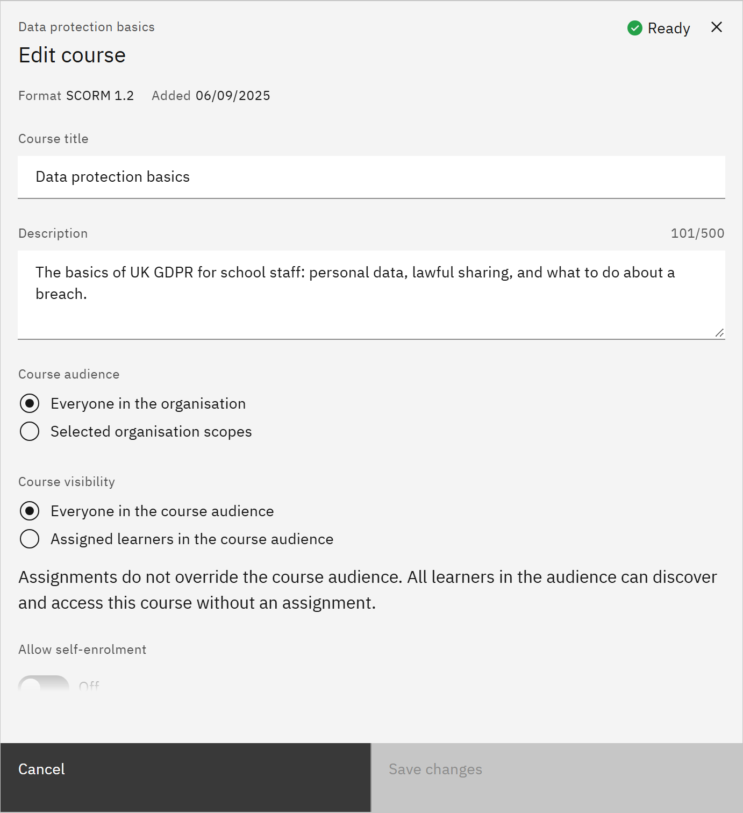

# Edit course details

You can change how a course is described and organised at any time. You need the **Course manager** or
**Organisation administrator** role.

1. Open Edit course

   In **Manage** ▸ **Courses**, open the row menu and choose **Edit details**. **Edit course** opens with the course's
   status, format and version at the top.

2. Change the description

   Edit the **Course title** and **Description** (up to 500 characters), the **Estimated duration (minutes)** and the
   **SCORM version**.

   

3. Organise it

   Under **Tags**, choose existing tags or type one in **Add a tag**. Tags can be used by learning rules to assign every
   course with a tag. Choose **Skills** and **Channels**; channels decide where learners find the course on
   **Courses**.

4. Change the thumbnail

   Under **Thumbnail**, drop a JPEG, PNG or WebP image of up to 2 MB, or choose a **Default colour**.

5. Save

   Click **Save changes**. The same window also holds the audience, self-enrolment, certificate, training materials,
   expiry and validity settings, each covered on its own page in this section. Training materials save on their own.
