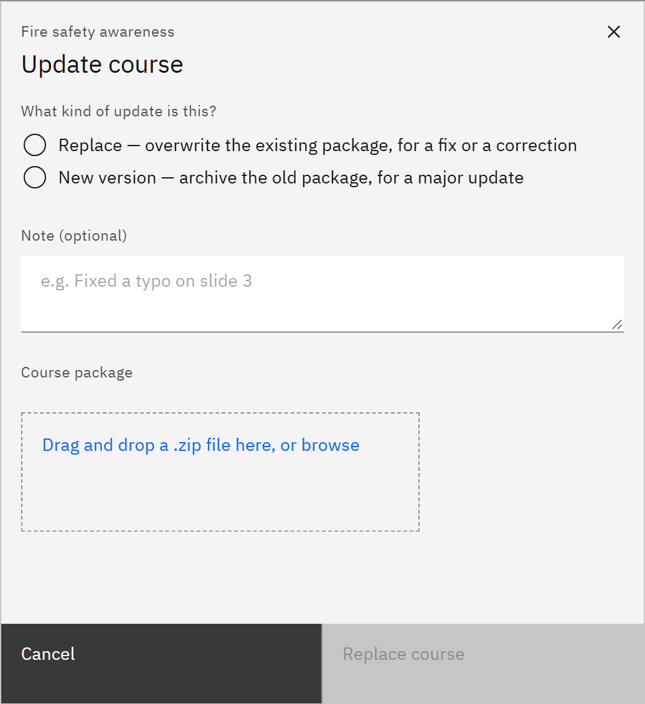

# Replace or add a course version

When a course's content changes, upload a new SCORM package to the same course. You need the **Course manager** or
**Organisation administrator** role.

1. Open Update course

   In **Manage** ▸ **Courses**, open the row menu and choose **Replace or add a version**.

2. Choose the kind of update

   Under **What kind of update is this?**, choose **Replace — overwrite the existing package, for a fix or a
   correction**, or **New version — archive the old package, for a major update**. Nothing is chosen for you.

   

3. Upload the package

   Add a **Note (optional)** to say what changed, then drop the new .zip file onto **Course package**. Click **Replace
   course** or **Add version**.

4. Check the result

   The new package is checked for malware before learners get it. If malware is found, the course keeps its previous
   package. Earlier packages are listed under **Version history** in **Edit details**, and the course list shows the
   version number.
