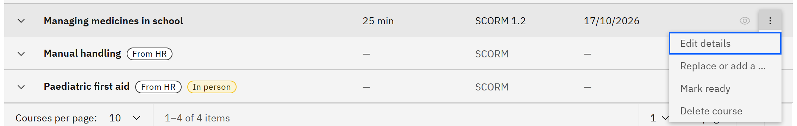

# Publish or unpublish a course

A course is a draft until you publish it. Learners can only launch ready courses. You need the **Course manager** or
**Organisation administrator** role.

1. Publish a draft

   In **Manage** ▸ **Courses**, open the **Draft** tab. Open the course's row menu and choose **Mark ready**. A message
   confirms "Course is ready", and the course moves to the **Ready** tab.

   

2. Unpublish a course

   On the **Ready** tab, open the row menu and choose **Move to draft**. Learners can no longer launch it, and learning
   rules stop assigning it. Existing assignments and records stay.

3. If you can't publish

   A course needs a processed SCORM package before it can be marked ready. Courses created from HR have no package
   until you add one with **Replace or add a version**. A course that's still processing can't be published or
   unpublished until it finishes.
