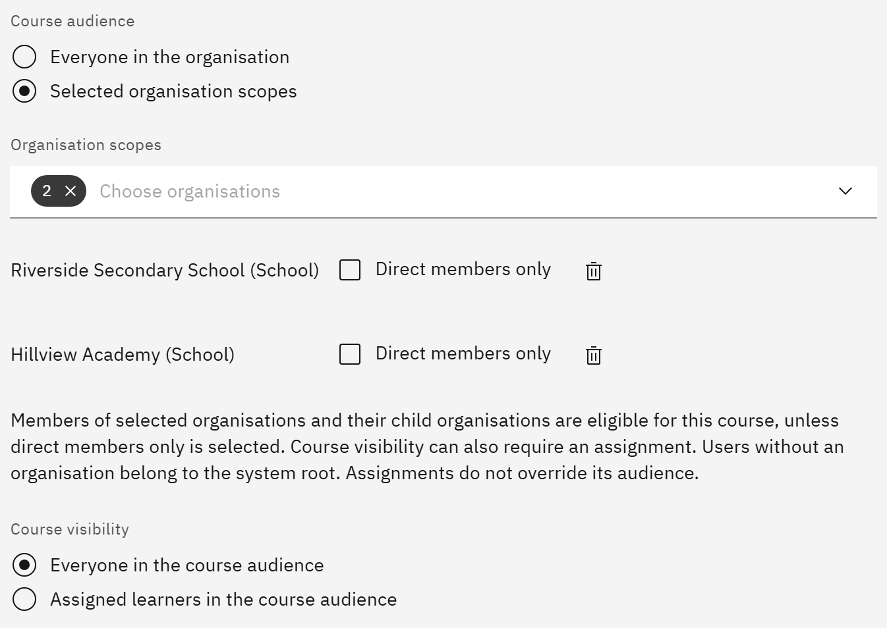

# Choose who can see a course

Two settings decide who can find and open a course: its audience, and whether they also need to be assigned it. You
need the **Course manager** or **Organisation administrator** role.

1. Open the course

   In **Manage** ▸ **Courses**, open the row menu and choose **Edit details**. You also set these when you add a
   course.

2. Set the audience

   Under **Course audience**, choose **Everyone in the organisation**, or **Selected organisation scopes** to limit it.
   For selected scopes, choose up to 50 organisations under **Organisation scopes**. Their child organisations are
   included unless you tick **Direct members only** next to one. People without an organisation belong to the top of
   your organisation.

   

3. Set the visibility

   Under **Course visibility**, choose **Everyone in the course audience** so everyone in the audience can find and open
   the course without an assignment. Choose **Assigned learners in the course audience** so only people who are
   assigned it can see it. With that choice, removing someone's last assignment removes their access.

4. Save

   Click **Save changes**. An assignment never overrides the audience: someone outside it can't be assigned the
   course, and learning rules and bulk assignment skip them. Check the audience before you assign a course widely.
