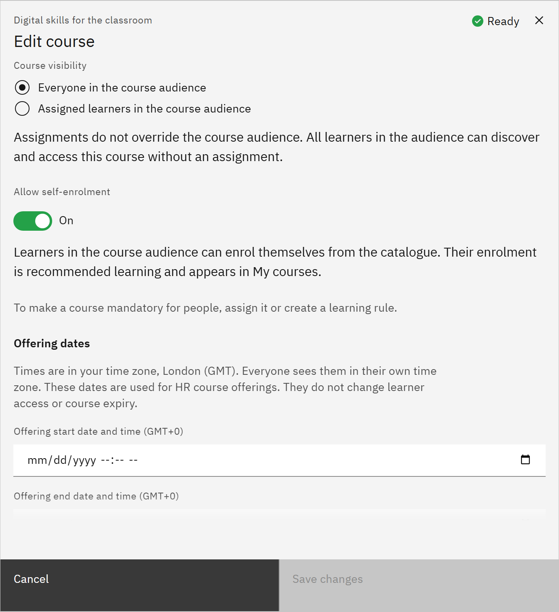

# Allow self-enrolment

You can let learners add a course to their own learning from the catalogue. You need the **Course manager** or
**Organisation administrator** role.

1. Open the course

   In **Manage** ▸ **Courses**, open the row menu and choose **Edit details**.

2. Turn on self-enrolment

   Turn on **Allow self-enrolment**. Learners in the course audience can then enrol themselves from the catalogue, and
   the course appears in their My learning as recommended learning. With it off, learners can still open the course from
   the catalogue, but only an assignment adds it to My learning.

   

3. Check it's available

   Self-enrolment isn't available when **Course visibility** is **Assigned learners in the course audience**, because
   only assigned learners can see the course. Learners can only enrol in a published course that hasn't expired.

4. Save

   Click **Save changes**. For courses from HR, the setting starts with HR's value until you change it here.
