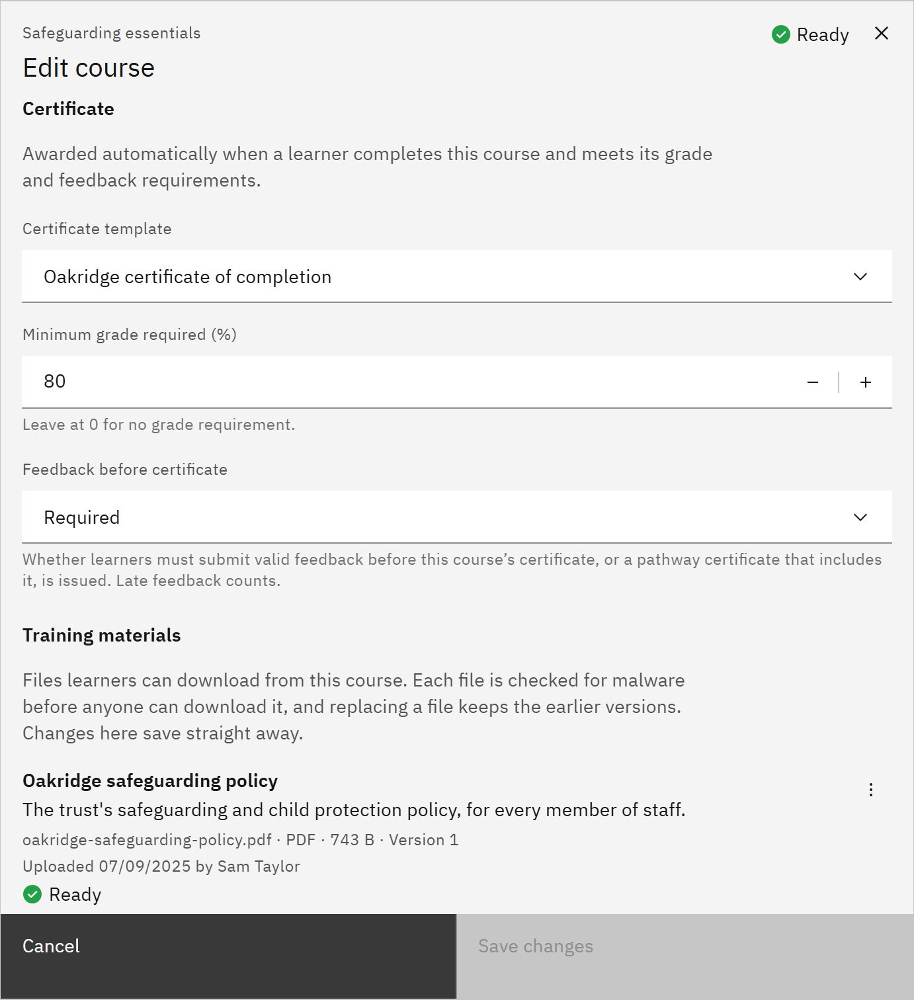

# Attach a certificate to a course

A course can award a certificate when learners complete it, optionally only above a grade. You need the **Course
manager** or **Organisation administrator** role.

1. Open the course

   In **Manage** ▸ **Courses**, open the row menu and choose **Edit details**.

2. Choose the template

   Under **Certificate**, choose a **Certificate template**. Choose **None** for no certificate. To create a template,
   see [Create a certificate template](../10-Channels-pathways-and-certificates/08-create-a-certificate-template.md).

   

3. Set the pass mark

   Under **Minimum grade required (%)**, enter the score a learner needs for the certificate. Leave it at 0 for no grade
   requirement. The SCORM package decides when the course is complete; the grade only decides the certificate.

4. Save

   Click **Save changes**. Certificates are issued automatically for each completion that meets the rule, and for
   renewals too. If your organisation requires course feedback first, the certificate waits for it: see
   [Require feedback before a certificate](./10-require-feedback-before-a-certificate.md). Nobody can award a
   certificate by hand.
