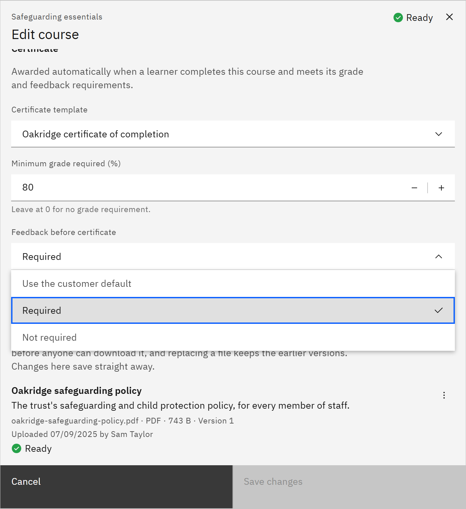

# Require feedback before a certificate

You can hold a course's certificate until the learner gives feedback on the course. You need the **Course manager** or
**Organisation administrator** role.

1. Open the course

   In **Manage** ▸ **Courses**, open the row menu and choose **Edit details**. The course needs a certificate template.

2. Choose the feedback rule

   Under **Certificate**, set **Feedback before certificate**. **Use the customer default** follows your organisation's
   setting, which an organisation administrator sets in **Manage** ▸ **Settings** ▸ **Course feedback** (off unless
   they turn it on). **Required** holds this course's certificate until the learner submits valid feedback. **Not
   required** issues it on completion.

   

3. Save

   Click **Save changes**. The rule also applies to a learning pathway certificate that includes this course. Late
   feedback still counts. The change applies to certificates not yet issued.
