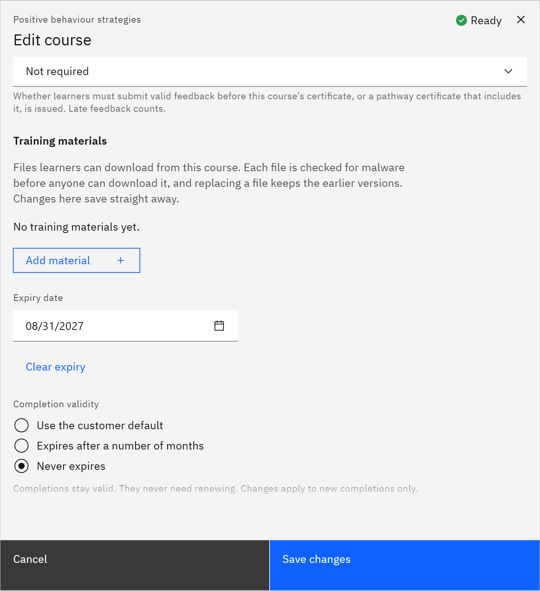

# Set a course expiry date

A course expiry date retires the course itself on a date, for example when its content goes out of date. It's
different from how long a learner's completion is valid. You need the **Course manager** or **Organisation
administrator** role.

1. Open the course

   In **Manage** ▸ **Courses**, open the row menu and choose **Edit details**.

2. Set the date

   Choose the **Expiry date**. Click **Clear expiry** to remove it.

   

3. Save

   Click **Save changes**. From that date the course list tags it **Expired**, learners can't launch it, learning rules
   stop assigning it and learners can't enrol in it. To set how long completions stay valid instead, see
   [Set how long a completion is valid](./12-set-how-long-a-completion-is-valid.md).
