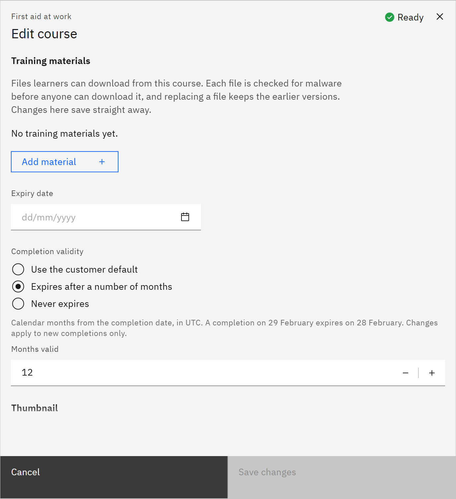

# Set how long a completion is valid

Completion validity sets how long a learner's completion counts before it expires and needs renewing. You need the
**Course manager** or **Organisation administrator** role.

1. Open the course

   In **Manage** ▸ **Courses**, open the row menu and choose **Edit details**.

2. Choose the validity

   Under **Completion validity**, choose:
   - **Use the customer default**: mandatory learning uses your organisation's default (12 months unless changed);
     other completions never expire.
   - **Expires after a number of months**, then enter **Months valid** from 1 to 120. Months count from the completion
     date; a completion on 29 February expires on 28 February.
   - **Never expires**: completions never need renewing.

   

3. Save

   Click **Save changes**. The change applies to completions recorded from now on; existing completions keep their
   expiry date. A learning rule can set its own validity for the courses it assigns. Expiring mandatory learning is
   renewed through learning rules: see [Run a renewal check](../11-Learning-rules/11-run-a-renewal-check.md).
