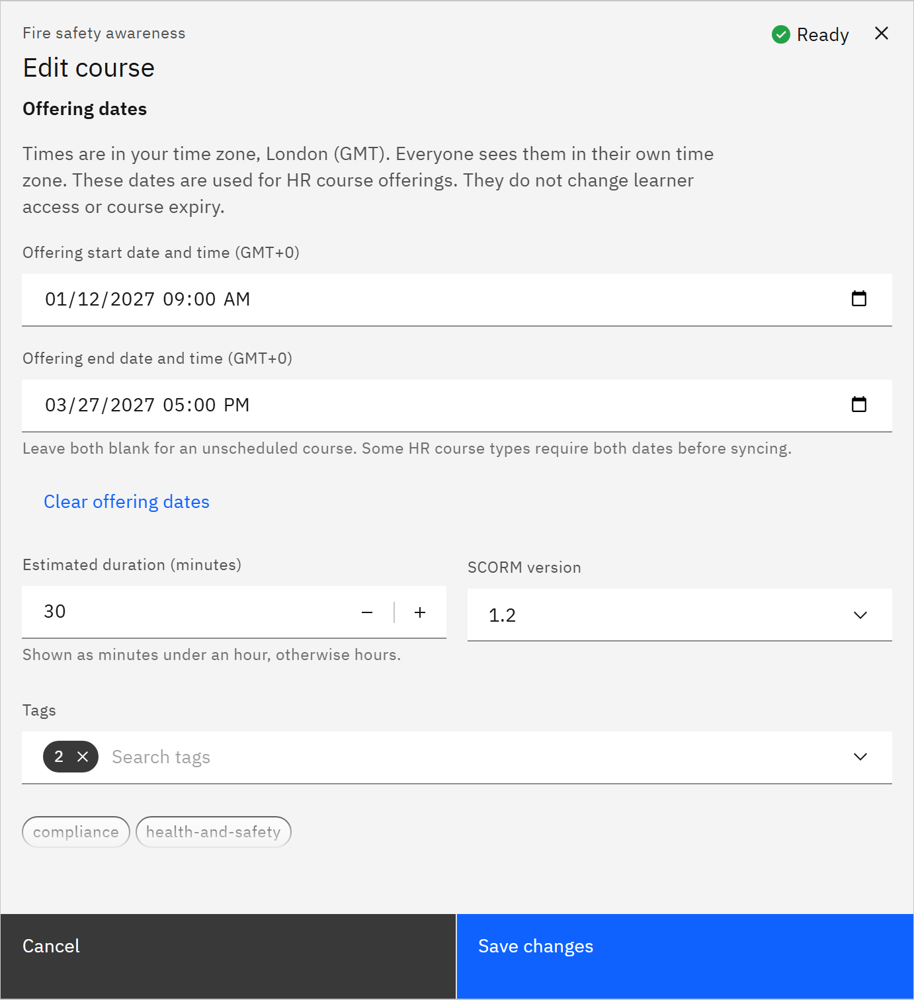

# Set course offering dates

Offering dates are the start and end of a course offering in your HR system. They only matter if your organisation
sends courses to HR. You need the **Course manager** or **Organisation administrator** role.

1. Open the course

   In **Manage** ▸ **Courses**, open the row menu and choose **Edit details**. You can also set them when you add a
   course.

2. Enter the dates

   Under **Offering dates**, enter the **Offering start date and time (UAE)** and **Offering end date and time (UAE)**.
   Times are UAE time (UTC+04:00). The dates don't change who can open the course or when it expires.

   

3. Check whether HR needs them

   If the message **Add offering dates to send this course to HR** appears, the HR course sync skips the course until
   it has dates. Learners can still use it.

4. Save

   Click **Save changes**. Leave both dates blank for an unscheduled course, or click **Clear offering dates**. Once a
   course may have been sent to HR, you can replace its dates but not clear them.
