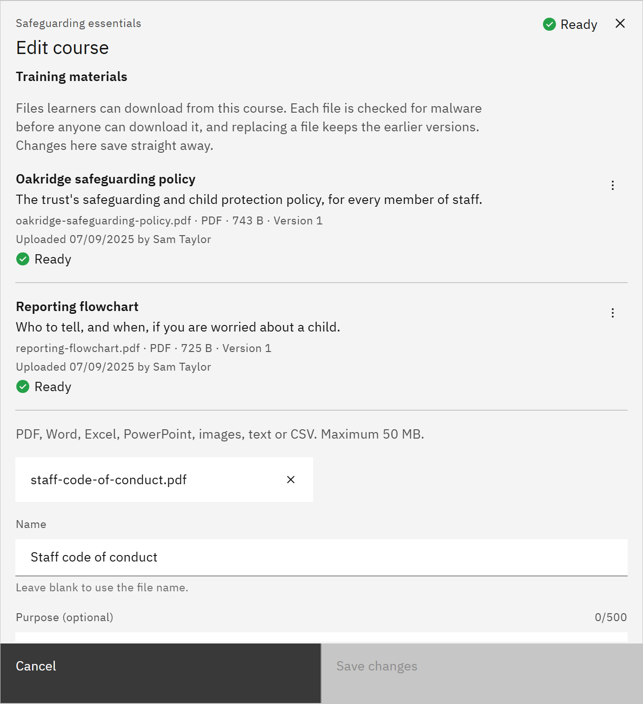

# Add course materials

Training materials are files learners can download from a course, such as handouts or policies. You need the **Course
manager** or **Organisation administrator** role.

1. Open the course

   In **Manage** ▸ **Courses**, open the row menu and choose **Edit details**, then scroll to **Training materials**.

2. Add a file

   Click **Add material**. Drop a PDF, Word, Excel, PowerPoint, image, text or CSV file of up to 50 MB. Enter a
   **Name**, or leave it blank to use the file name, and a **Purpose (optional)**. Click **Upload material**. Training
   materials save straight away, separately from **Save changes**.

   

3. Wait for the malware check

   A new file shows **Checking for malware**. Click **Check malware status** to update it. Learners can download it once
   it shows **Ready**. A file marked **Malware found** can never be downloaded.

4. Update or remove a file

   Open a material's menu to **Download** it, **Upload new version**, **Edit details** or **Remove** it. Learners only
   get the current version; earlier versions stay listed under **Earlier versions** for you.

   Files that could contain code, such as macro-enabled Office files, web pages, scripts and archives, are refused.
