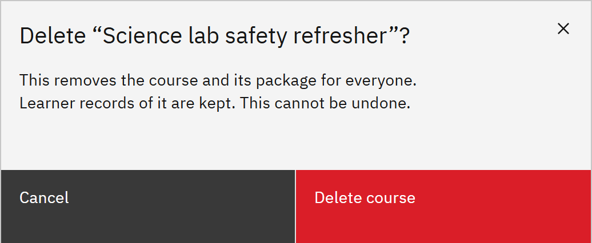

# Delete a course

Deleting removes a course and its package for everyone. You need the **Course manager** or **Organisation
administrator** role.

1. Choose Delete course

   In **Manage** ▸ **Courses**, open the course's row menu and choose **Delete course**.

2. Confirm

   Read the message and click **Delete course**. You can't undo this from the Courses page.

   

   > **Note:** Deleting can't be undone. Learners can no longer open the course, but their
   > records, completions and certificates are kept. To hide a course without deleting it, use **Move to draft** or set
   > an **Expiry date** instead.
