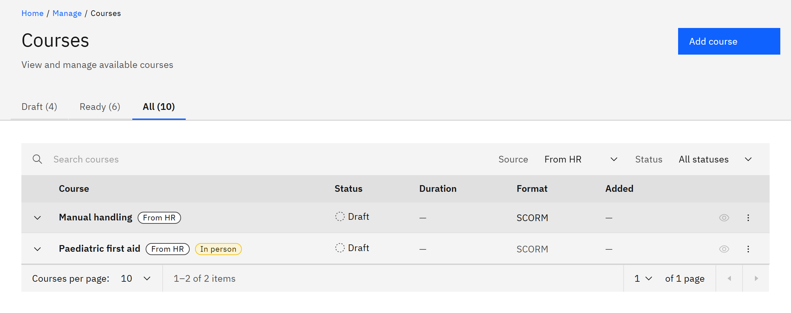

# Work with courses from HR

GrowthXP can import courses from your HR system, such as Microsoft Dynamics 365 Finance & Operations,
so the two catalogues agree. You need the **Course manager** or **Organisation administrator** role. Importing courses
from HR is off unless TMRW support turns it on for your organisation.

1. Find courses from HR

   In **Manage** ▸ **Courses**, set **Source** to **From HR**. Courses that came from HR have a **From HR** tag. A new
   HR course arrives as an unpublished draft with no content.

   

2. Add the content

   Open the row menu and choose **Replace or add a version** to upload its SCORM package.

3. Set it up and publish it

   Choose **Edit details** to set the audience, visibility and certificate, then **Mark ready** to publish it.

4. Know what HR keeps in step

   The title, description and self-enrolment setting come from HR. If only HR changed them since the last sync, HR's
   values are taken. If both sides changed, GrowthXP keeps its own value and shows the conflict to
   administrators in **Manage** ▸ **Settings** ▸ **Synchronisation**. A course cancelled or removed in HR is never
   deleted here.

5. Know about in-person courses

   HR courses with a classroom or location are tagged **In person** and imported as drafts. In-person delivery isn't
   supported in this version.

6. Use HR course types in rules

   Learning rules can assign every course with a given HR course type. See
   [Choose courses by tag or HR course type](../11-Learning-rules/03-choose-courses-by-tag-or-hr-course-type.md).
