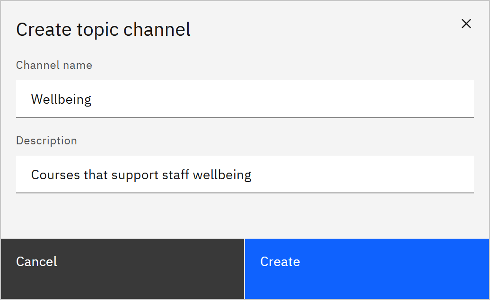

# Create a channel

Channels group courses by topic, such as "Compliance", so learners can browse them on **Courses**. You need the
**Course manager** or **Organisation administrator** role.

1. Open Channels

   Click **Manage** in the header, then **Channels** under **Content**. If there are none yet, the page says "No
   channels yet. Create one to organise your content."

2. Enter the details

   Click **Create channel** at the top of the page. In **Create topic channel**, enter the **Channel name** and a
   **Description**.

   

3. Create it

   Click **Create**. The channel appears in the list. Next,
   [add courses to it](./02-add-courses-to-a-channel.md). You can [rename it](./03-edit-a-channel.md) later.

A channel only groups courses for browsing. To make learning mandatory for people, assign it or use a learning rule.
