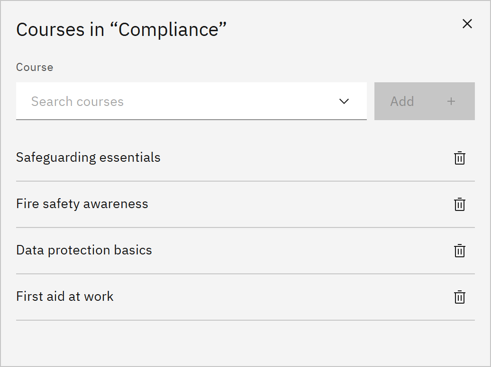

# Add courses to a channel

A channel shows learners the courses you put in it. A course can be in more than one channel. You need the **Course
manager** or **Organisation administrator** role.

1. Open the channel's courses

   In **Manage** ▸ **Channels**, click the **Courses** icon at the end of the channel's row. The window lists the courses
   already in it.

2. Add a course

   Under **Course**, search for and choose a course, then click **Add**.

   

3. Remove a course

   Click **Remove** next to a course to take it out of the channel. The course itself isn't changed.

4. Close the window

   Changes save as you make them. The **Courses** column on the Channels list shows the new count. You can also choose
   a course's channels in its **Edit details** window.
