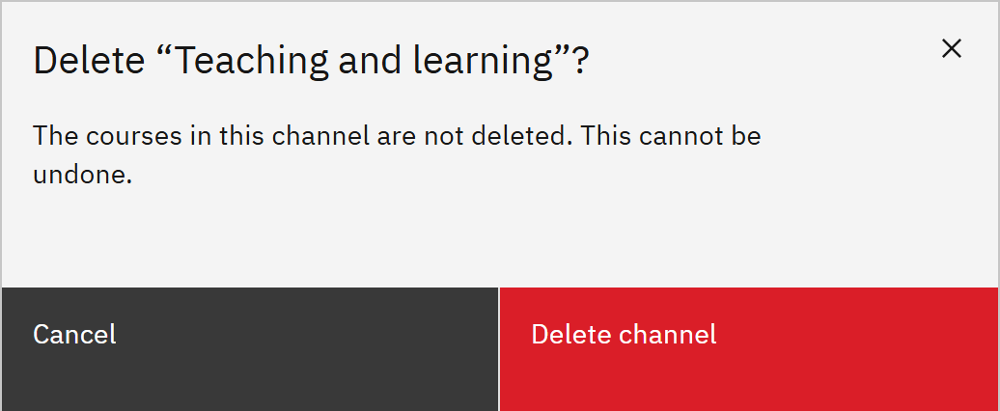

# Delete a channel

You can delete a channel you no longer need. You need the **Course manager** or **Organisation administrator** role.

1. Choose Delete

   In **Manage** ▸ **Channels**, click the **Delete** icon at the end of the channel's row.

2. Confirm

   Click **Delete channel**. The courses in the channel aren't deleted; they just no longer appear under that channel.
   You can't undo this.

   
