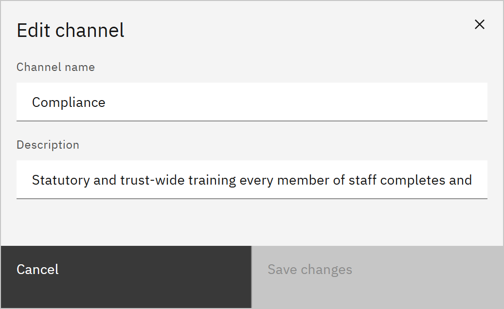

# Edit a channel

You can rename a channel or change its description. You need the **Course manager** or **Organisation administrator**
role.

1. Open the channel

   In **Manage** ▸ **Channels**, click the **Edit** icon at the end of the channel's row.

2. Change the details

   In **Edit channel**, change the **Channel name**, the **Description**, or both. A channel always needs a name.

   

3. Save

   Click **Save changes**. It becomes available once you've changed something. The channel keeps its courses, and
   learners see the new name on **Courses**.

If the change can't be saved, **Channel not saved** says why and the window stays open with what you typed.
