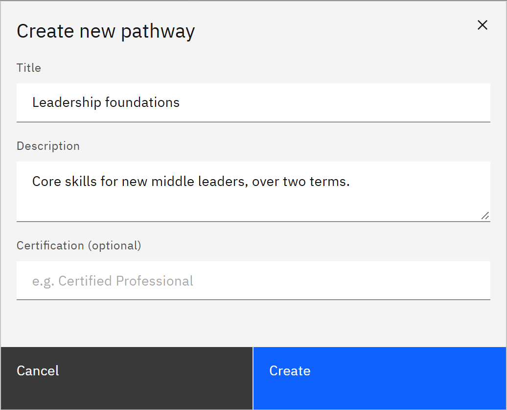

# Create a learning pathway

A learning pathway is an ordered set of courses, such as an induction programme, with an optional certificate at the
end. You need the **Course manager** or **Organisation administrator** role.

1. Open Learning pathways

   Click **Manage** in the header, then **Learning pathways** under **Content**. Existing pathways show as cards. If
   there are none yet, the page says **No pathways yet**. If it says **Pathways not loaded**, click **Try again**.

2. Create the pathway

   Click **New pathway**. In **Create new pathway**, enter the **Title**, a **Description**, and a **Certification
   (optional)**: the name of what learners achieve, such as "Inducted staff member".

   

3. Create it

   Click **Create**. The pathway opens in the editor, ready for you to
   [add courses](./06-build-a-learning-pathway.md). If it can't be created, **Pathway not created** says why and the
   window keeps what you typed.
