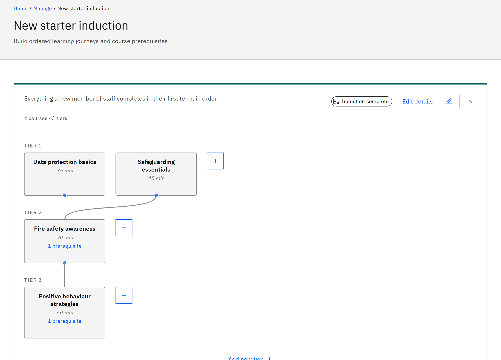

# Build a learning pathway

You build a pathway from tiers: learners work through the courses in the first tier, then the next. You can also link
courses as prerequisites. You need the **Course manager** or **Organisation administrator** role.

1. Open the pathway

   In **Manage** ▸ **Learning pathways**, click the pathway's card. The editor shows the courses and tiers, for example
   "4 courses · 2 tiers". Each course card shows the course's duration, if it has one.

2. Add courses

   Click **Add course** at the end of a tier, or **Add new tier** under the last tier. Choose a **Course** and click
   **Add**. If **Courses not loaded** appears, click **Try again**: you can't add courses until the course list loads.

   

3. Arrange the courses

   Each course card has controls to **Move up a tier**, **Move down a tier**, **Move left**, **Move right**, **Move to
   own tier** and **Remove**.

4. Link prerequisites

   Drag the handle on a course (**Drag to link prerequisite**) onto a course in the next tier. The card shows how many
   prerequisites it has. Click a link to delete it.

5. Save

   Click **Save changes**. Nothing is saved until you do. If the changes can't be saved, **Changes not saved** appears
   above the buttons with the reason, and your changes stay in the editor. Learners only see a pathway when they can see
   every course in it, so check each course's audience.
