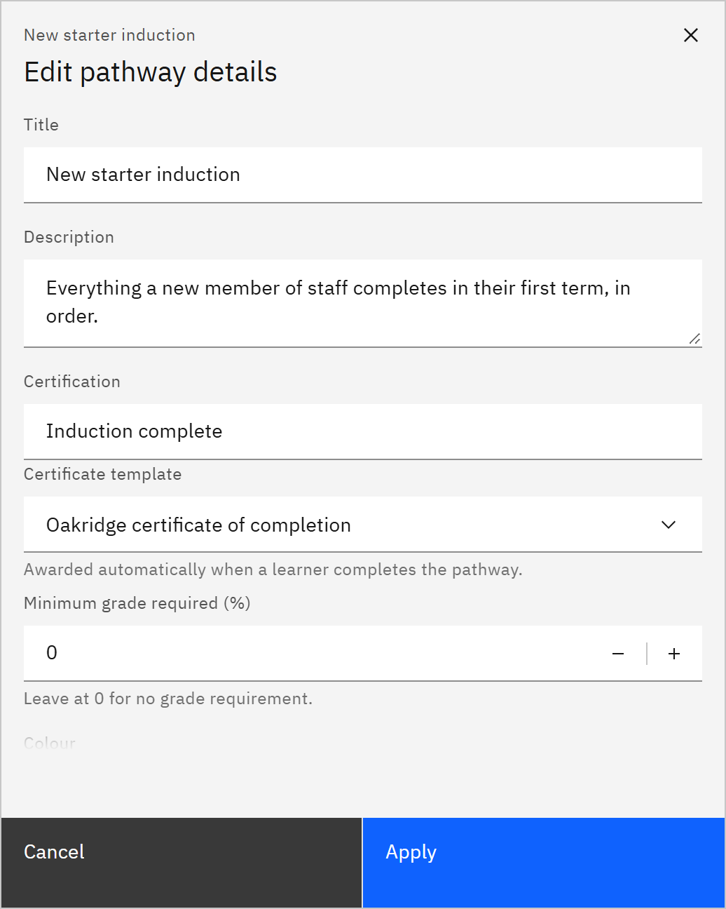

# Edit or delete a learning pathway

You can change a pathway's details and certificate, or delete it. You need the **Course manager** or **Organisation
administrator** role.

1. Open the details

   In **Manage** ▸ **Learning pathways**, click the pathway's card, then **Edit details**.

2. Change the details

   In **Edit pathway details**, change the **Title**, **Description**, **Certification** and **Colour**.

   

3. Add a certificate

   Under **Certificate template**, choose the template to award automatically when a learner completes the pathway.
   Under **Minimum grade required (%)**, enter the average grade needed across its courses, or leave it at 0. A pathway
   certificate also needs each course's feedback rule to be met.

4. Save

   Click **Apply**, then **Save changes** in the editor.

5. Delete the pathway

   Click **Delete pathway** at the bottom of the editor, then **Delete pathway** again in the confirmation. If it can't
   be deleted, **Pathway not deleted** says why and the pathway stays open.

   > **Note:** Learners no longer see a deleted pathway. Its courses, and pathway certificates already awarded, are
   > kept. This can't be undone.
