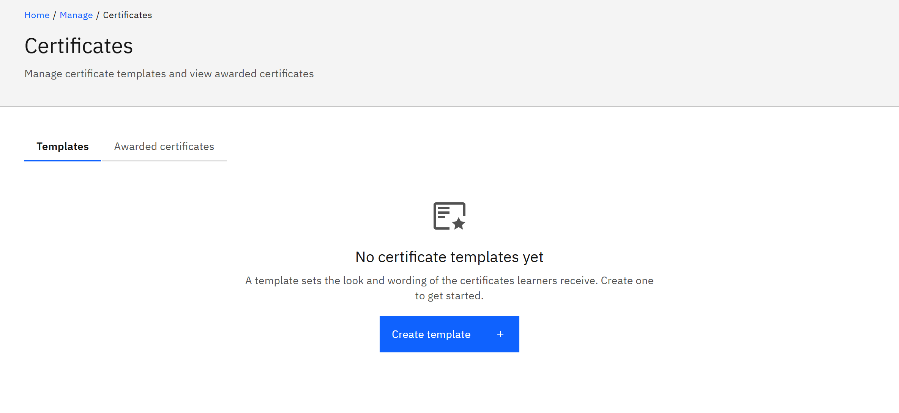
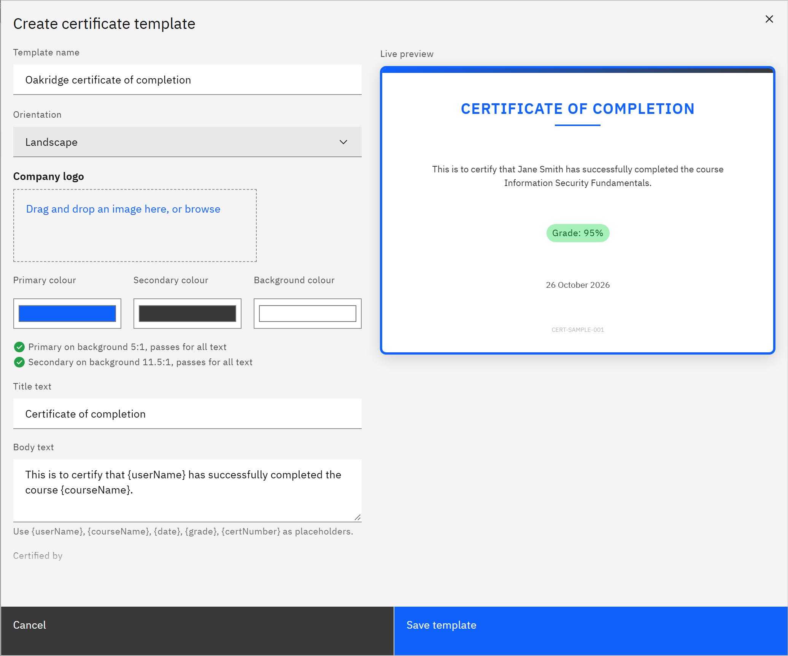

# Create a certificate template

A certificate template sets the look and wording of the certificates learners receive. You attach templates to
courses and learning pathways. You need the **Course manager** or **Organisation administrator** role.

1. Open Certificates

   Click **Manage** in the header, then **Certificates** under **Content**, and stay on the **Templates** tab. If there
   are no templates yet, the page says **No certificate templates yet**.

2. Start a template

   Click **Create template**. It's in the middle of the page when there are no templates, and in the table's toolbar
   when there are.

   

3. Set the look

   Enter the **Template name** and choose the **Orientation**: **Landscape** or **Portrait**. Drop a **Company logo**,
   and choose the **Primary colour**, **Secondary colour** and **Background colour**. The contrast checks under the
   colours tell you whether the text will be easy to read.

4. Write the text

   Enter the **Title text** and **Body text**. In the body you can use `{userName}`, `{courseName}`, `{date}`,
   `{grade}` and `{certNumber}`, which are filled in for each learner. Add **Certified by**, **Certifier name** and
   **Footer text**. Choose whether to **Include grade**, **Include date** and **Include course name**.

5. Check and save

   Check the **Live preview**, which uses sample details. Turn on **Set as default** to make it your default template.
   Click **Save template**.

   
