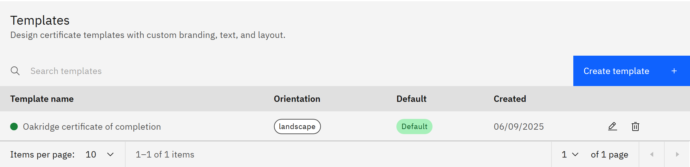

# Edit a certificate template

You can change a certificate template's look and wording, or delete it. You need the **Course manager** or
**Organisation administrator** role.

1. Open the template

   In **Manage** ▸ **Certificates** ▸ **Templates**, find the template, using **Search templates** if you need to, and
   click its **Edit** icon.

2. Make your changes

   In **Edit certificate template**, change any field and check the **Live preview**. Click **Save template**.

   

3. Know what changes

   Certificates issued from now on use the new version. Certificates already issued keep the version they were issued
   with, so learners' existing certificates don't change.

4. Delete a template

   Click the template's **Delete** icon, then **Delete template**. Certificates already awarded from it are kept. You
   can't undo this. Check which courses and pathways use it first, and choose another template for them.
