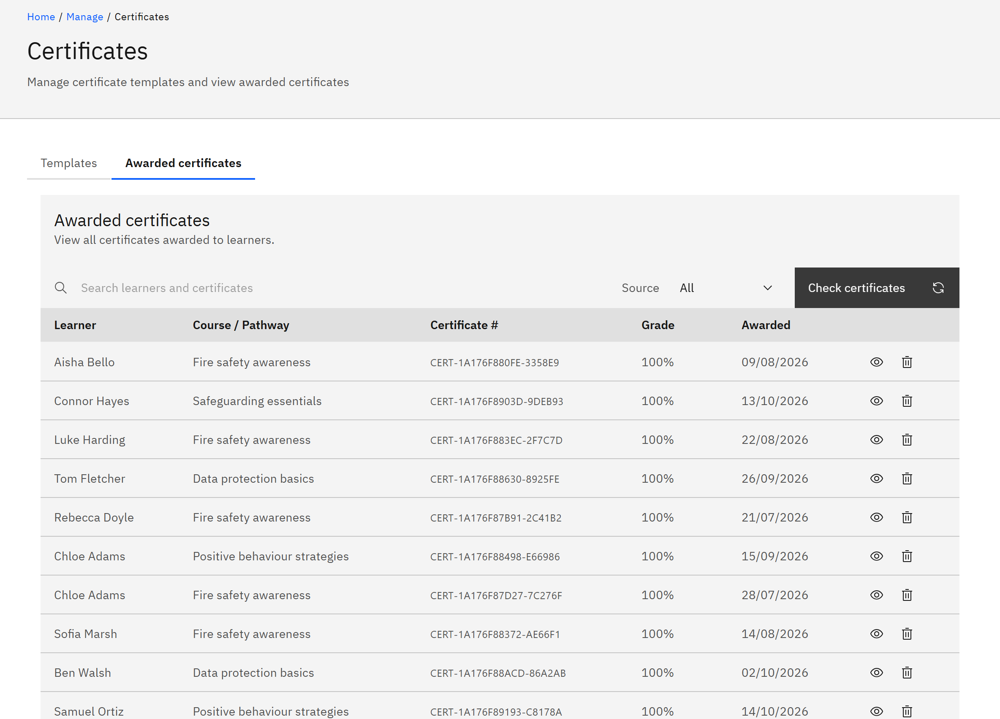

# View awarded certificates

The **Awarded certificates** tab lists every certificate learners have received. You need the **Course manager** or
**Organisation administrator** role.

1. Open Awarded certificates

   In **Manage** ▸ **Certificates**, click the **Awarded certificates** tab.

2. Find a certificate

   Type a learner's name or a certificate number in **Search learners and certificates**, and use **Source** to choose a
   course or pathway. The table shows the **Learner**, **Course / Pathway**, **Certificate #**, **Grade** and the date
   it was **Awarded**.

   

3. Open a certificate

   Click **Open certificate page** to view, print or download it.

4. Issue missing certificates

   Certificates are issued automatically when learners complete a course or pathway that has a template. If some seem
   to be missing, for example after you attached a template to a course, click **Check certificates**. The message
   says how many were awarded, or **No missing certificates found**.

5. Revoke a certificate

   Click **Revoke** on the certificate's row, then **Revoke certificate**.

   > **Note:** The learner loses the certificate and can no longer download it. You can't undo this.
