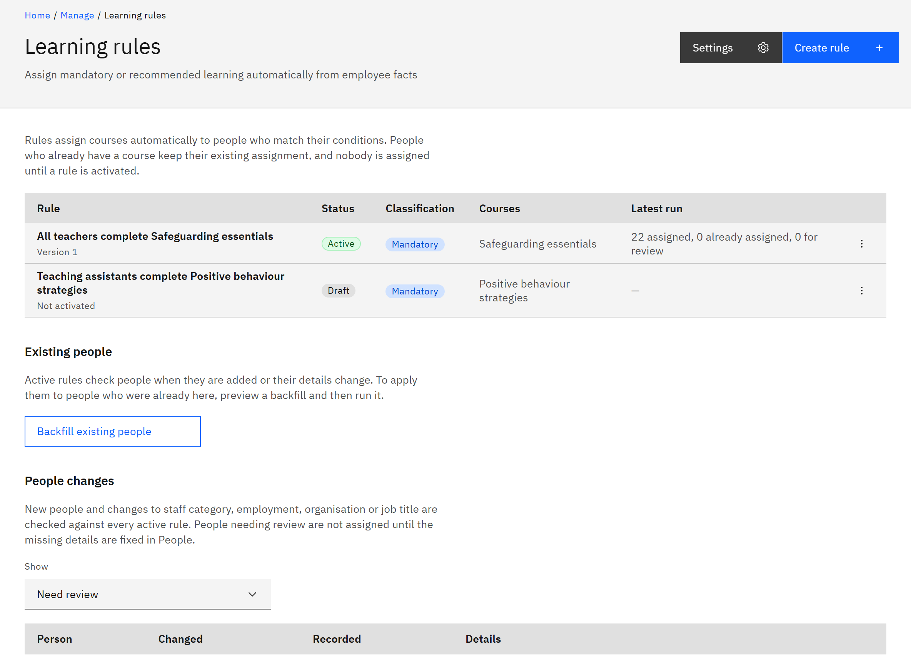

# How learning rules work

Learning rules assign courses automatically from people's details, such as their staff category, organisation or
how long they've worked for you. HR managers and organisation administrators create and run them; course managers can
see them, to know which rules use their courses.

1. A rule chooses courses and people

   A rule chooses specific courses, every course with a tag, or every course with an HR course type. It applies to
   people who match all its conditions: staff category, organisation, worker type, job title and months employed. It
   assigns the courses as **Mandatory** or **Recommended**, with due dates worked out from your settings.

2. Nothing happens until you activate it

   A new rule is a draft. You preview who it would assign, then activate it. Activation assigns the courses to everyone
   who matches, unless they already have them. Editing an active rule saves a new version that waits until you activate
   it; until then the active version stays in force.

   

3. Active rules keep people up to date

   Active rules check people when they join or when their staff category, employment, organisation or job title
   changes. New courses with the rule's tag or HR course type are assigned without editing the rule. People whose
   employment hasn't started yet are assigned on their start date. To check everyone again at once, run a
   [backfill](./09-backfill-existing-people.md). Your organisation can also have rules re-checked on a schedule: that's
   off unless TMRW support turns it on.

4. Rules respect the course audience

   A rule only assigns a course to people in that course's audience, and only published courses that haven't expired.
   Someone who already has a course keeps their assignment. If the rule is mandatory, the course becomes mandatory for
   them.

5. How rules remove learning

   When someone stops matching a rule, their open mandatory assignments from it are withdrawn, unless your settings say
   to keep them. Completed learning is never withdrawn. Deactivating a rule stops new assignments but leaves existing
   ones in place. You can't remove a rule's assignment on **Learning assignments**: change the rule or the person's
   details instead.

6. Rules renew expiring learning

   Completed mandatory learning is assigned again before it expires. See
   [Run a renewal check](./11-run-a-renewal-check.md).
