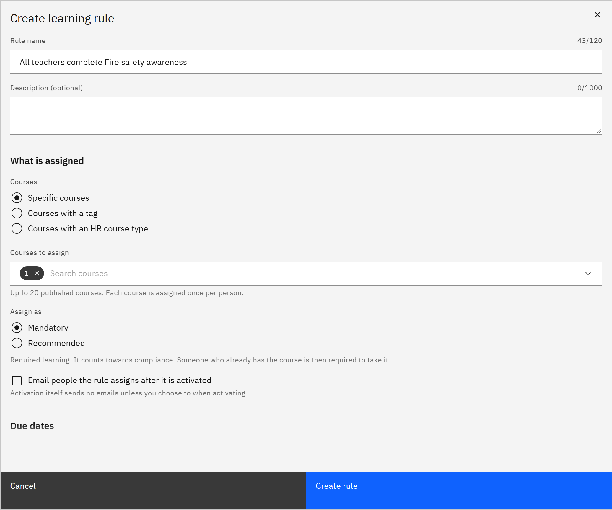

# Create a learning rule

A learning rule assigns courses automatically to everyone who matches its conditions. You need the **HR manager** or
**Organisation administrator** role.

1. Start a rule

   Click **Manage** in the header, then **Learning rules** under **Organisation**. Click **Create rule**.

2. Name it

   Enter a **Rule name**, such as "All teachers complete Safeguarding essentials", and a **Description (optional)**.

3. Choose what's assigned

   Under **Courses**, choose **Specific courses**, then choose up to 20 published courses in **Courses to assign**. To
   choose courses by tag or HR course type instead, see
   [Choose courses by tag or HR course type](./03-choose-courses-by-tag-or-hr-course-type.md).

   

4. Choose mandatory or recommended

   Under **Assign as**, choose **Mandatory** (the default) or **Recommended**. Tick **Email people the rule assigns
   after it is activated** if people should be emailed when the rule assigns them later.

5. Set the details

   Set [due dates, renewals and validity](./05-set-due-dates-and-renewals-on-a-rule.md) and
   [who the rule applies to](./04-choose-who-a-rule-applies-to.md).

6. Create it

   Click **Create rule**. The rule is saved as a draft and nobody is assigned yet. Next,
   [preview and activate it](./06-preview-and-activate-a-rule.md).
