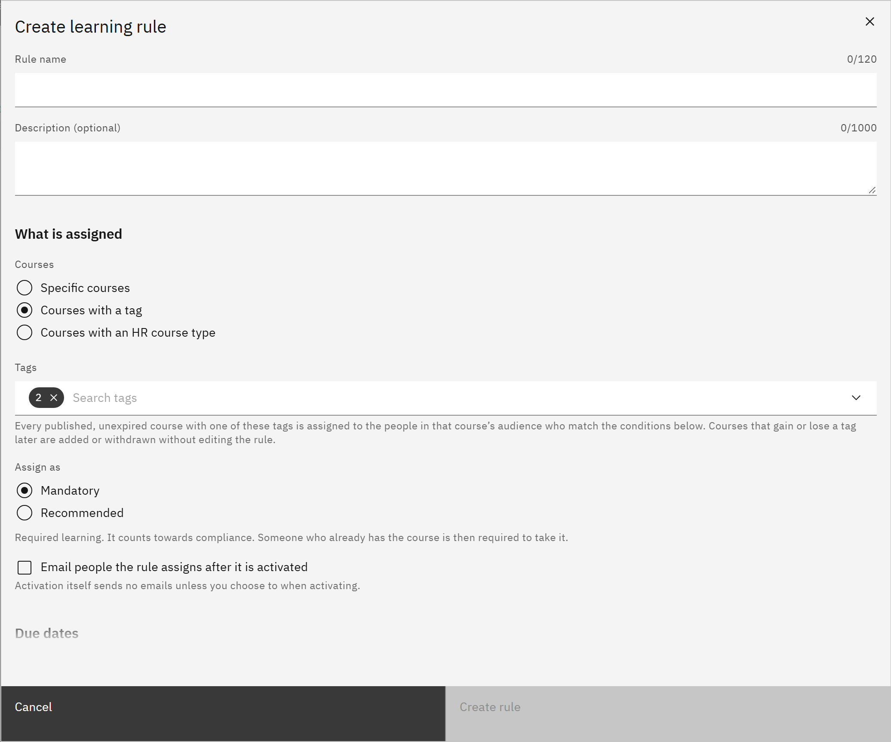

# Choose courses by tag or HR course type

Instead of listing courses, a rule can assign every course with a tag, or every course with an HR course type. The
rule then keeps up as courses change. You need the **HR manager** or **Organisation administrator** role.

1. Open the rule

   In **Manage** ▸ **Learning rules**, click **Create rule**, or open a rule's row menu and choose **Edit**.

2. Choose by tag

   Under **Courses**, choose **Courses with a tag**, then choose up to 20 **Tags**. Course managers add tags to courses
   in **Edit details**; if no course has a tag yet, the field says so.

   

3. Or choose by HR course type

   If your courses are linked to your HR system, you can choose **Courses with an HR course type**, then choose up to 20
   **HR course types**. This choice only appears when courses have HR course types.

4. Know what's assigned

   Every published, unexpired course with one of the tags or types is assigned to the people in that course's audience
   who match the rule. When a course gains or loses the tag or type, or is published or expires, it's added to or
   withdrawn from the rule automatically, without editing the rule.

5. Save

   Click **Create rule** or **Save changes**, then preview and activate the rule.
