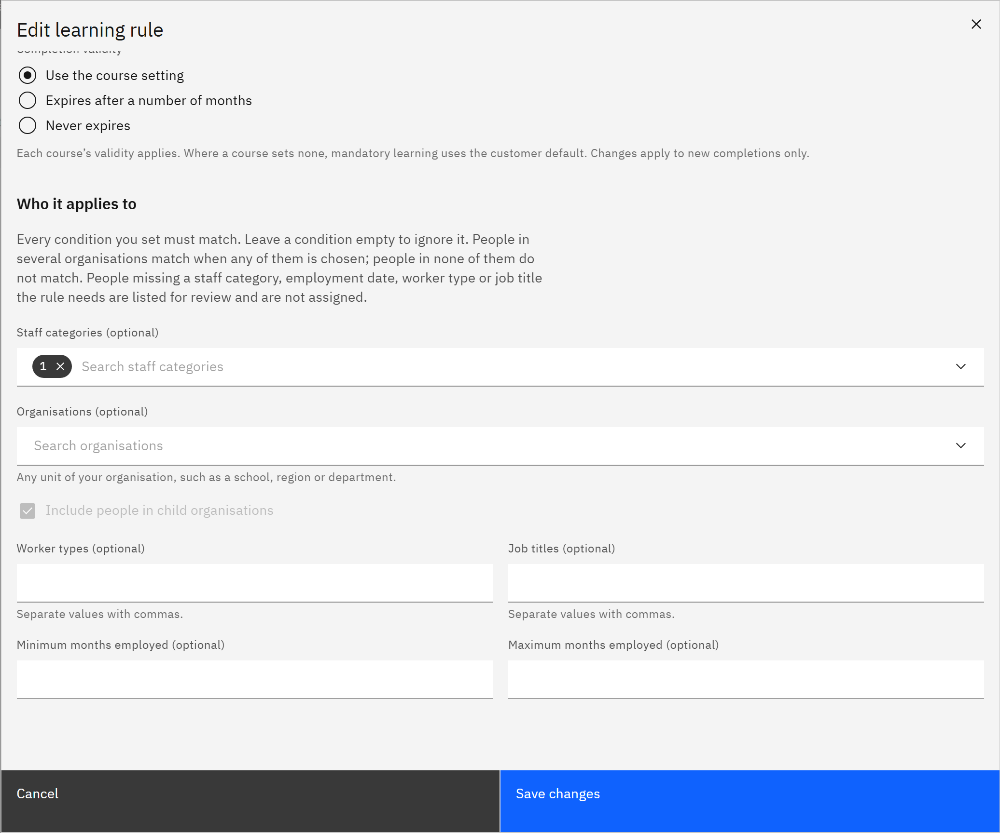

# Choose who a rule applies to

A rule's conditions decide who it assigns. You need the **HR manager** or **Organisation administrator** role.

1. Open the conditions

   In the rule's window, scroll to **Who it applies to**. Every condition you set must match. Leave a condition empty to
   ignore it.

   

2. Choose staff categories

   Under **Staff categories (optional)**, choose categories such as Teacher or Teaching assistant.

3. Choose organisations

   Under **Organisations (optional)**, choose any units of your organisation, such as a school, region or department.
   Tick **Include people in child organisations** to include the units below them. People in several organisations
   match when any of them is chosen; people in none of them don't match.

4. Add other conditions

   Enter **Worker types (optional)** and **Job titles (optional)**, separated by commas. Use **Minimum months employed
   (optional)** and **Maximum months employed (optional)** to target, for example, people in their first year.

5. Know who's held for review

   People missing a staff category, employment start date, worker type or job title the rule needs aren't assigned.
   They're listed for review in the preview and under **People changes**, so you can fix their details on **People**.
