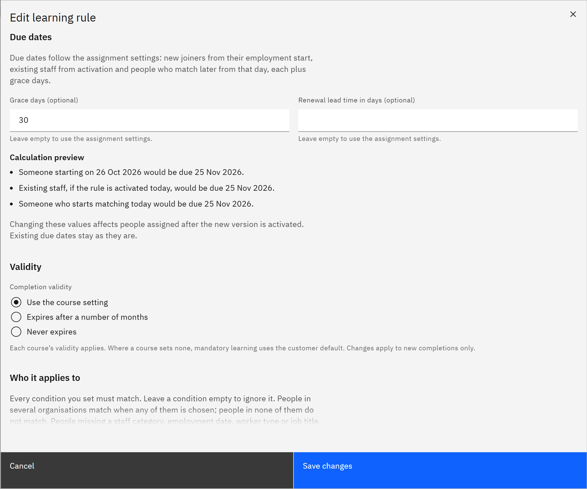

# Set due dates and renewals on a rule

A rule works out each person's due date from a starting date plus grace days. You can use your organisation's
assignment settings or set the rule's own. You need the **HR manager** or **Organisation administrator** role.

1. Know where due dates start

   For mandatory rules, new joiners are due from their employment start date, existing staff from the day the rule is
   activated, and people who match later from the day they match, each plus grace days. Recommended learning is never
   overdue, and only has a due date if your assignment settings give recommended learning due dates.

2. Set grace days and renewal lead time

   Under **Due dates**, enter **Grace days (optional)** to override the number of days added to the starting date, and
   **Renewal lead time in days (optional)** to override how long before expiry the next cycle is assigned. Both take 0
   to 365. Leave them empty to use the [assignment settings](./12-change-assignment-settings.md).

   

3. Check the examples

   **Calculation preview** shows example due dates for a new joiner, for existing staff if you activate today, and for
   someone who starts matching today.

4. Set the validity

   Under **Validity**, choose **Use the course setting**, **Expires after a number of months** or **Never expires**.
   This overrides each course's validity for learning assigned by this rule.

5. Know when changes apply

   Changes apply to people assigned after you activate the new version. Existing due dates stay as they are.
