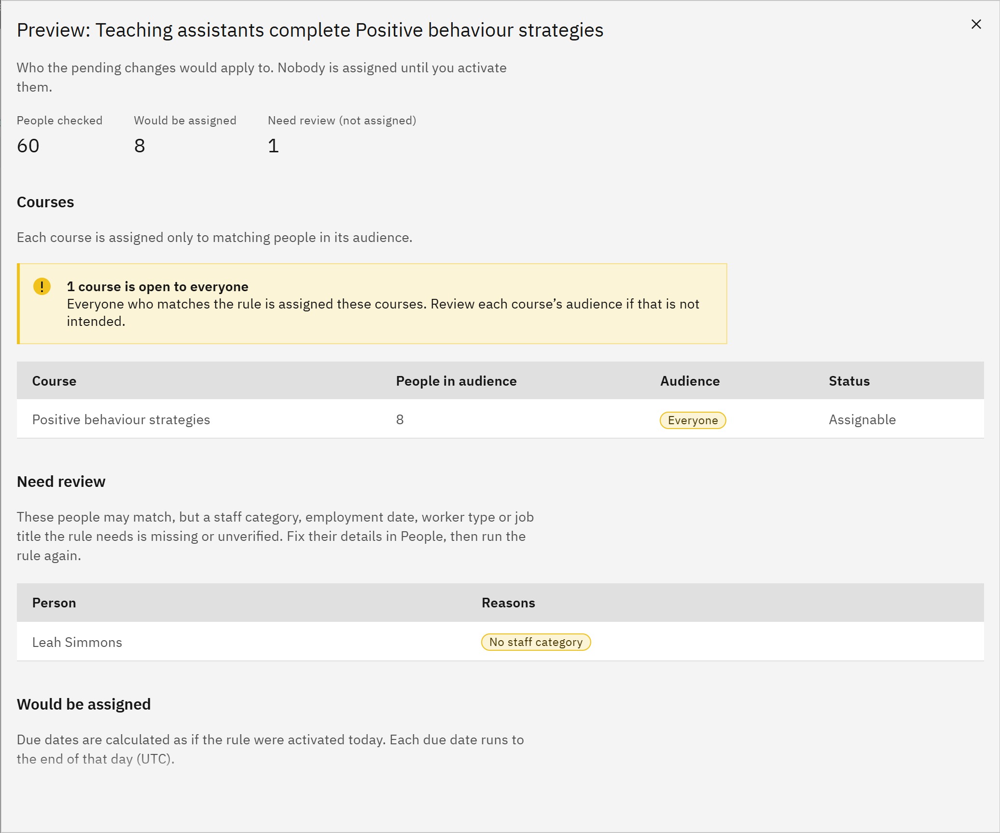

# Preview and activate a rule

Before a rule assigns anyone, preview it, then activate it. You need the **HR manager** or **Organisation
administrator** role.

1. Preview the rule

   In **Manage** ▸ **Learning rules**, open the rule's row menu and choose **Preview**. The preview checks people in
   batches: **People checked so far**, **Would be assigned** and **Need review (not assigned)**. Click **Check more
   people** until everyone has been checked.

   

2. Check the courses and people

   **Courses** lists each course with the number of people in its audience. A warning appears if a course is open to
   everyone. **Need review** lists people missing details the rule needs, with the reasons. **Would be assigned** lists
   each person with their courses, whether they're a new joiner, existing staff or newly matching, and their due date.

3. Activate it

   Close the preview, open the row menu and choose **Activate** (or **Reactivate** for an inactive rule). The window
   says which version you're activating.

4. Decide about emails

   **Email the people assigned now** is off by default, so a first activation doesn't send a burst of emails. Tick it
   if people should be emailed about their new learning.

5. Confirm and check the run

   Click **Activate rule**. The rule's status changes to **Active** and assignments are created in the background. The
   **Latest run** column shows progress, then a summary such as "40 assigned, 2 already assigned, 1 for review".
