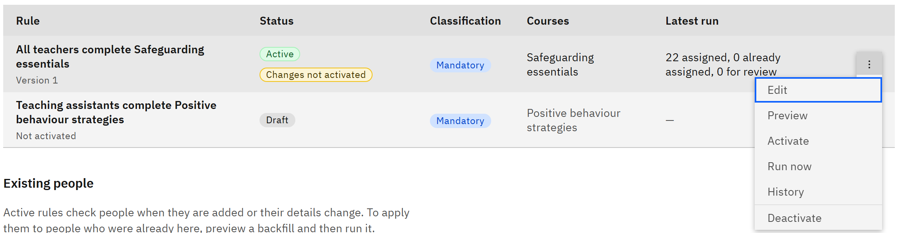

# Change or deactivate a rule

You can change a rule, run it again, stop it, or retire it. You need the **HR manager** or **Organisation
administrator** role.

1. Change a rule

   In **Manage** ▸ **Learning rules**, open the rule's row menu and choose **Edit**. Make your changes and click **Save
   changes**. For an active rule, the window says **Changes need activation**: the active version stays in force, and
   the rule shows **Changes not activated** until you [preview and activate](./06-preview-and-activate-a-rule.md) the
   new version.

   

2. Run an active rule now

   Choose **Run now** to check everyone against the active version straight away, for example after you've fixed
   people's details. It's unavailable while a run is in progress.

3. Deactivate a rule

   Choose **Deactivate**, then **Deactivate rule**. Nobody new is assigned by the rule. Existing assignments, including
   open ones, stay in place. Choose **Reactivate** later to turn it back on.

4. Delete a rule

   For a draft or inactive rule, choose **Delete**, then **Delete rule**. The rule is retired. Assignments it created and
   its version history are kept.
