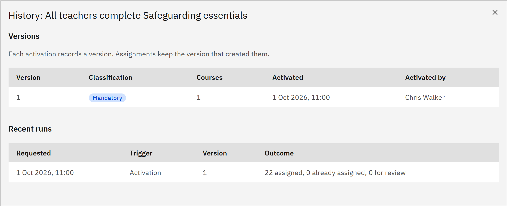

# View rule history

A rule's history shows every version that was activated and every run. You need the **HR manager**, **Course
manager** or **Organisation administrator** role.

1. Open the history

   In **Manage** ▸ **Learning rules**, open the rule's row menu and choose **History**.

2. Read the versions

   **Versions** lists each activated version with its **Classification**, **Courses**, when it was **Activated** and
   **Activated by** whom. Assignments keep the version that created them.

   

3. Read the runs

   **Recent runs** lists when each run was **Requested**, its **Trigger** (**Activation**, **Run now**, **Scheduled**,
   **Backfill** or **Course change**), the **Version** and the **Outcome**, such as how many people were assigned,
   already assigned, held for review or withdrawn.
