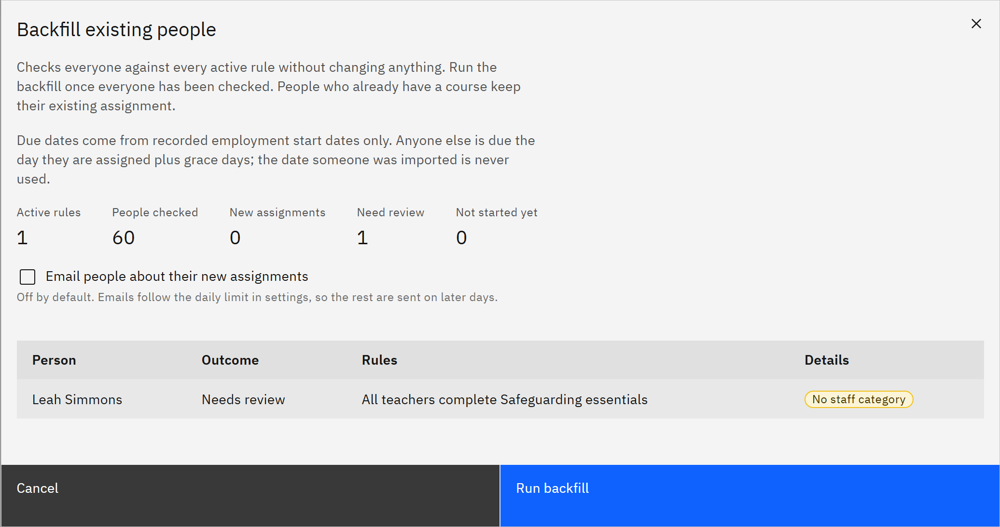

# Backfill existing people

A backfill checks everyone against every active rule at once, for example after people were imported from HR, or
after changes to organisations or staff categories. You need the **HR manager** or **Organisation administrator**
role.

1. Open the backfill

   In **Manage** ▸ **Learning rules**, under **Existing people**, click **Backfill existing people**. If no rule is
   active, the window asks you to activate one first.

2. Preview it

   The window checks people without changing anything: **Active rules**, **People checked so far**, **New
   assignments**, **Need review** and **Not started yet**. Click **Check more people** until everyone has been checked.
   The table lists each person, the outcome, the rules and the details.

   

3. Know the due dates

   Due dates come from recorded employment start dates only. Anyone else is due the day they're assigned plus grace
   days. The date someone was imported is never used.

4. Decide about emails

   **Email people about their new assignments** is off by default. If you tick it, emails follow the daily limit in
   **Settings**, so the rest are sent on later days.

5. Run it

   Click **Run backfill**. A message says how many rules are running. People who already have a course keep their
   existing assignment.
