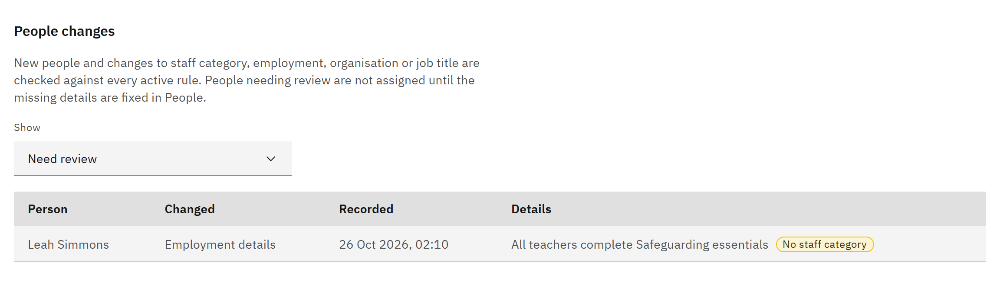

# Review people changes

When people join or their details change, active rules check them. **People changes** shows who's waiting, who was
checked and who needs their details fixing. You need the **HR manager** or **Organisation administrator** role.

1. Open People changes

   In **Manage** ▸ **Learning rules**, scroll to **People changes**.

2. Choose a list

   Under **Show**, choose **Need review**, **Waiting for start date**, **Waiting to be evaluated**, **Evaluation
   failed** or **Evaluated**. The table shows each **Person**, what **Changed** (such as **New person**,
   **Organisation** or **Job title**), when it was **Recorded**, and **Details**.

   

3. Fix people needing review

   **Need review** lists people who might match a rule but are missing a staff category, employment start date,
   worker type or job title, or whose details conflict. They aren't assigned until the details are fixed. Fix them on
   **People**, or in your HR system if the details come from HR; the change is checked again automatically.

4. Check people waiting to start

   **Waiting for start date** lists people whose employment hasn't started; they're assigned on their start date.
   **Evaluation failed** people are checked again after their next change or a backfill. Click **Show more people** to
   see more.
