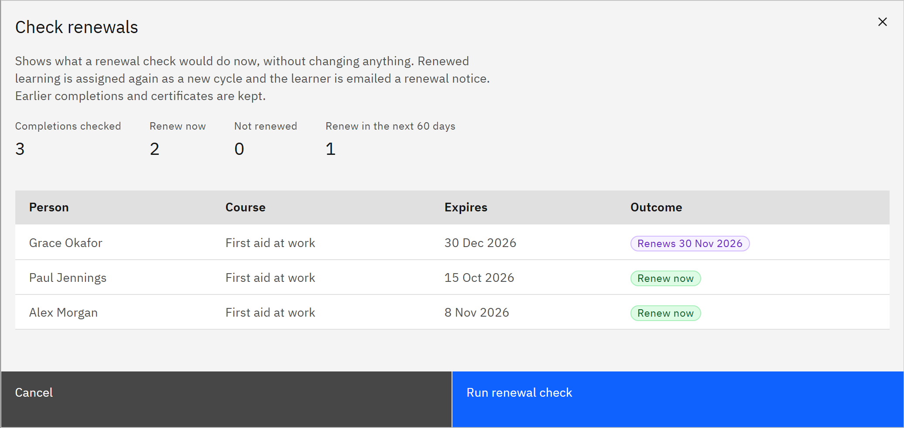

# Run a renewal check

Mandatory learning that expires is assigned again when its renewal lead time starts, due on the expiry date, and the
learner is emailed a renewal notice. A renewal check makes these renewals. You need the **HR manager** or
**Organisation administrator** role.

1. Check when renewals last ran

   In **Manage** ▸ **Learning rules**, scroll to **Renewals**. The line under the heading says when the latest check
   ran and what it did. Checks run only when someone runs them, unless TMRW support has turned on daily checks for your
   organisation.

2. Preview a check

   Click **Check renewals**. The preview changes nothing: it shows **Completions checked**, **Renew now**, **Not
   renewed** and how many renew in the next few days. Click **Check more completions** until all have been checked. The
   table lists each person, course, expiry date and outcome.

   

3. Run it

   Click **Run renewal check**. Each renewal is a new cycle of the course, due on the expiry date, and the learner is
   emailed a renewal notice. Learning that has already expired is assigned at once. Earlier completions and
   certificates are kept.

4. Check what wasn't renewed

   **Not renewed** lists learning that was due but wasn't assigned again, with the **Reason**, such as "Not mandatory",
   "Employment ended" or "Outside course audience". It's renewed by the next check once the reason no longer applies.
