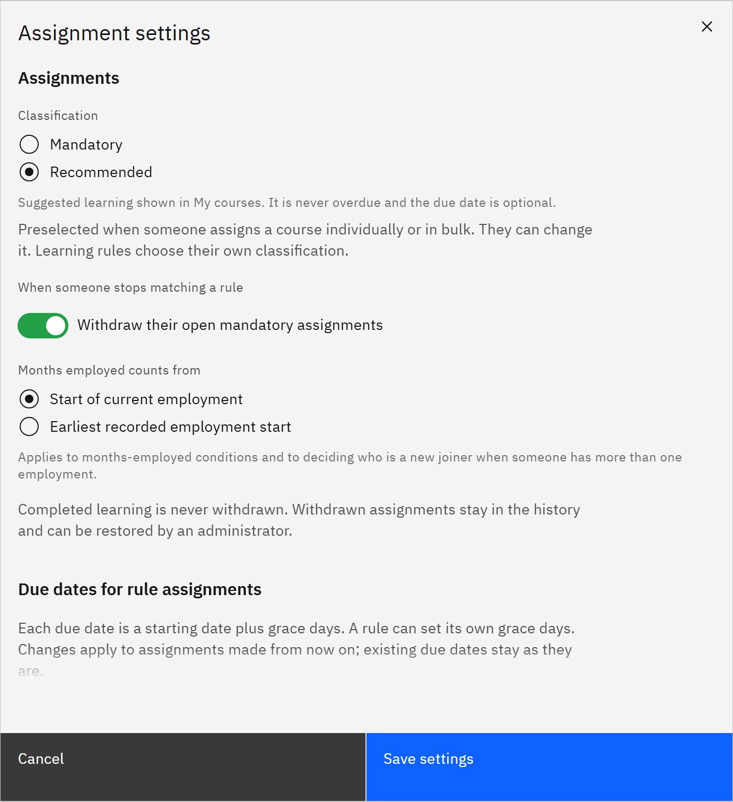

# Change assignment settings

Assignment settings are the defaults behind assignments and learning rules: classification, due dates, renewals,
validity and emails. You need the **HR manager** or **Organisation administrator** role. Course managers can open the
settings but not change them.

1. Open the settings

   In **Manage** ▸ **Learning rules**, click **Settings**.

2. Set the assignment defaults

   Under **Assignments**, choose the default **Classification**, which is preselected when someone assigns a course.
   Under **When someone stops matching a rule**, choose to **Withdraw their open mandatory assignments** or **Keep
   their open assignments**. Under **Months employed counts from**, choose **Start of current employment** or
   **Earliest recorded employment start**.

   

3. Set the due dates

   Under **Due dates for rule assignments**, set the **Grace days** (30 by default). Choose when **New joiners are due**
   and when **Existing staff when a rule is activated are due**. Tick **Give recommended learning a due date** if you
   want one; it's still never overdue. Set the **Renewal lead time (days)**: the next cycle is assigned this many days
   before expiry and is due on the expiry date.

4. Set validity

   Under **Completion validity**, set the **Default validity for mandatory learning (months)**, 12 by default (0 means
   it never expires), used when neither the course nor the rule sets one. Choose when learning shows as expiring soon.

5. Set new-joiner timing and emails

   Under **New and changed people**, choose whether people whose employment hasn't started are assigned **On their
   employment start date** or **As soon as they match a rule**. Set **Automated assignment emails per day** (500 by
   default); emails over the limit are sent on later days, and 0 sends none.

6. Save

   Check the example due dates at the bottom, then click **Save settings**. Changes apply to assignments and
   completions from now on; existing due dates and expiry dates don't change.
