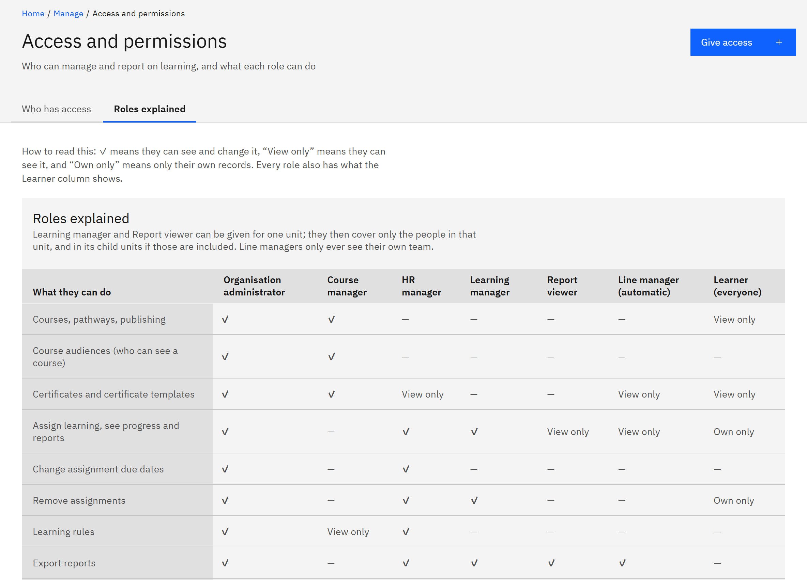

# Understand the roles

Growth Experience Platform has seven roles. A person's role decides which pages they see under **Manage** and what they
can change there.

1. Know the roles

   | Role | Who has it | What they can do | Where it applies |
   |---|---|---|---|
   | **Learner** | Everyone who signs in | Take courses, give feedback, and see their own learning, certificates and calendar | Their own records |
   | **Line manager** | Anyone with people reporting to them | See their team's learning in **My team**, the team's deadlines and learning reports, and export them | Their direct reports and everyone below them |
   | **Learning manager** | Given on Access and permissions | Add people to organisations, assign and remove learning, follow progress and reports. They can't export | The units they're given |
   | **Report viewer** | Given on Access and permissions | See learning progress, reports and the deadlines calendar without changing anything or exporting | The units they're given |
   | **Course manager** | Given on Access and permissions | Create, edit and publish courses, channels, learning pathways and certificate templates, and choose who can see each course | Whole organisation |
   | **HR manager** | Given on Access and permissions | Assign learning to anyone, change due dates, manage learning rules, and run and export learning reports | Whole organisation |
   | **Organisation administrator** | Given on Access and permissions | Everything, including **Access and permissions**, **People**, **Notifications**, **Settings**, the HR integration, **Organisation structure** and the **Audit log** | Whole organisation |

   Every role also includes everything a learner can do.

2. Know which access is automatic

   You never give the **Learner** or **Line manager** role. Everyone who signs in is a learner. Anyone who has people
   reporting to them in the manager hierarchy becomes a line manager for those people, and stops being one when nobody
   reports to them any more. To change who someone's line manager is, change their manager in HR, or in **People** if the
   manager isn't set by HR. See [Set a line manager](./07-set-a-line-manager.md).

3. Know what "one unit" means

   You can give **Learning manager** and **Report viewer** for the **Whole organisation** or for **One unit**, such as a
   school. A unit includes its child units if **Include child units** is ticked. A learning manager also gets People
   employment details, line managers and account controls, but only when they're given the role for the whole
   organisation.

4. Check the full detail

   Go to **Manage** → **Access and permissions** and open the **Roles explained** tab. The table lists every role as a
   column. **✓** means they can see and change it, **View only** means they can see it, and **Own only** means only
   their own records. An asterisk (\*) marks access a learning manager or report viewer has only when they're given the
   role for the whole organisation.

   

   The table is built from the permissions the system enforces, so it's always up to date.
