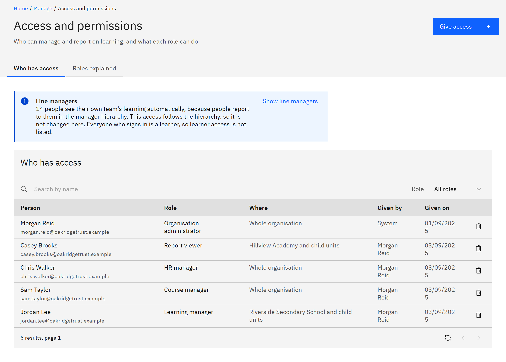

# See who has access

See everyone who has been given a role, where it applies and who gave it.

You need the **Organisation administrator** role.

1. Open Access and permissions

   Go to **Manage** → **Access and permissions**. The **Who has access** tab opens first.

   

2. Find a person or a role

   Type in **Search by name**, or choose a role in the **Role** filter. Each row shows the **Person**, their **Role**,
   **Where** it applies (the whole organisation, or a unit), **Given by** and **Given on**. People imported from HR who
   haven't signed in yet are marked **Imported from HR — not signed in yet**. Access given to a group shows a **Group**
   tag.

3. Check line managers

   The **Line managers** note at the top says how many people see their team's learning automatically. Click **Show line
   managers** to list them, or choose **Line managers (automatic)** in the **Role** filter. You can't change these rows
   here, because they follow the manager hierarchy. Learners aren't listed at all, because everyone who signs in is a
   learner.

4. Tidy up older grants

   A row may say **Old report viewer (no effect)**. This role gives nothing beyond a learner. See
   [Replace an old report viewer grant](./10-replace-an-old-report-viewer-grant.md). A row that says
   **Organisation administrator (organisation-wide grant)** still works. To tidy it up, give the same person
   **Organisation administrator**, then remove the older row.
