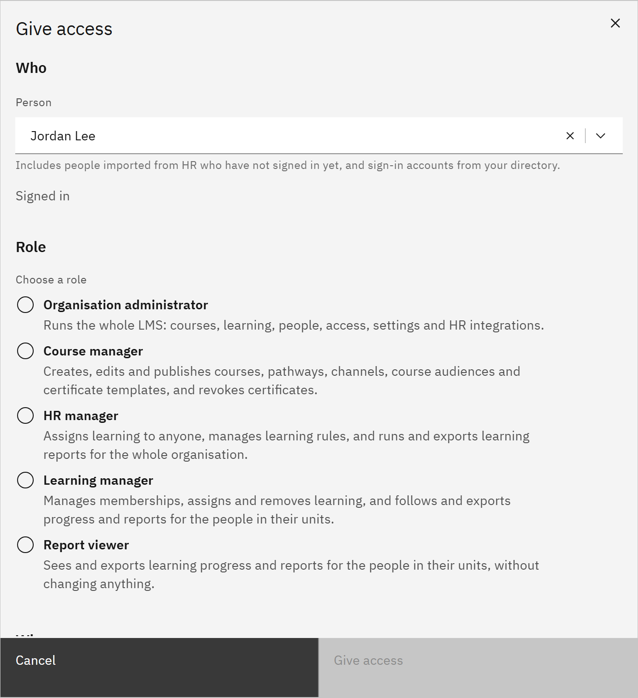
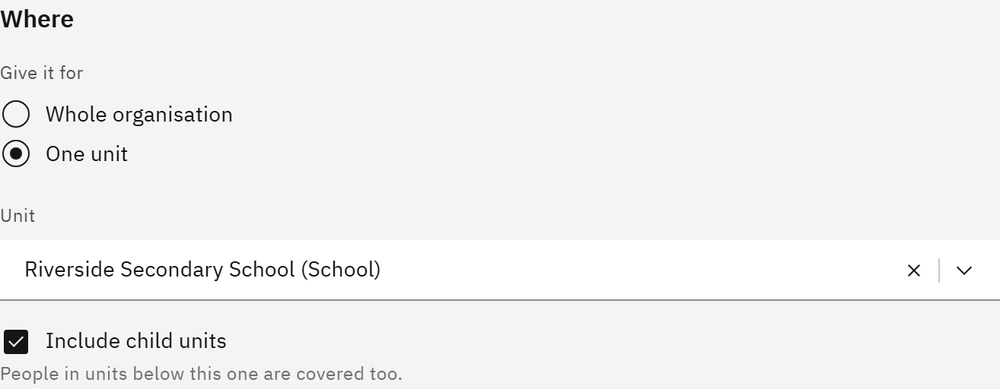

# Give someone access

Give one role to one person. You can give several roles to the same person by repeating these steps.

You need the **Organisation administrator** role. You can only give roles whose permissions you hold yourself.

1. Open Give access

   Go to **Manage** → **Access and permissions** and click **Give access**.

2. Choose who

   Under **Who**, type a name or email in **Person**. The results include people already in the platform, people
   imported from HR who haven't signed in yet, and sign-in accounts from your organisation's directory. Each result says
   which it is: **Signed in**, **Imported from HR — not signed in yet** or **Directory account only**.

   For someone imported from HR, the platform looks for the sign-in account that uses their work email. If it finds one,
   it says **Sign-in account found**, and links that account to them when you give access. If it finds none, or more than
   one, choose their account in **Their sign-in account**. For a **Directory account only** result, the person is added to
   the platform with that account.

   

3. Choose the role

   Under **Role**, pick one role. Each has a one-line summary, and **What exactly can they do?** lists everything it
   allows. Roles you can't give aren't shown, and a note says why.

4. Choose where it applies

   **Organisation administrator**, **Course manager** and **HR manager** always cover the whole organisation. For
   **Learning manager** or **Report viewer**, choose **Whole organisation** or **One unit**. For one unit, choose it in
   **Unit**, then leave **Include child units** ticked to cover the units below it too.

   

5. Give access

   Click **Give access**. The **Access given** message confirms it, and says whether their sign-in account was linked or
   they were added to the platform. If the person is already signed in, they may need to reload the page to see their new pages.

   If the page says **Access changes are not enabled**, giving access is switched off for your organisation. Contact
   TMRW support.
